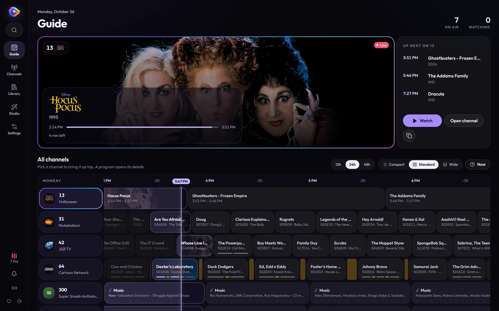

# MosaicTV Documentation

Turn your media library into scheduled 24/7 live TV channels — with station
breaks, watermarks, "up next" cards, and standard M3U + XMLTV output that
plugs into Plex, Jellyfin, Emby, or any IPTV player.

## Start here

| | |
| - | - |
| 🚀 [Installation](install.md) | Docker run, Docker Compose, Portainer, Unraid — plus updating and every setting |
| 🏁 [Getting Started](getting-started.md) | Zero to your first live channel, step by step, in about ten minutes |
| 👀 [A tour of MosaicTV](tour.md) | Every screen, one after another, with what each is for |
| 🧑‍🍳 [How-tos](how-to.md) | Recipes: a Saturday-morning block, cartoons as the half-hours they aired as, a Halloween month, a music channel, a guide channel… |

## Guides

| Guide | What's in it |
| ----- | ------------ |
| 📚 [Your Library](library.md) | Adding libraries, naming, scanning, metadata and title logos, fixing matches, specials and extras, music, reading from Plex/Jellyfin/Emby, title pages |
| 🗓 [Channels & Scheduling](channels.md) | Collections, playback orders, broadcast episodes, rotations, time blocks, seasons, holiday episodes, the broadcast clock, music, the guide channel, the playout |
| 🎨 [Branding: Logos, Watermarks & Breaks](branding.md) | On-screen logos, watermarks, station breaks and idents, promos, "up next" cards |
| 📺 [Watching](watching.md) | The Guide, TV mode and its keys, retro looks, picture in picture, casting, parental controls, phones |
| 📡 [Connecting Players](clients.md) | Jellyfin, Emby, Plex, VLC, IPTV apps — and shared HLS vs MPEG-TS |
| ⚡ [Hardware Acceleration](hardware-acceleration.md) | Hardware requirements, CPU vs GPU encoding (NVIDIA/QuickSync/VAAPI/AMF/VideoToolbox), setup per platform, encoding profiles |
| 🔒 [Security](security.md) | Sign-in, player links, and watching away from home the safe way |
| 🛠 [Troubleshooting & Backup](troubleshooting.md) | Common issues, the log, backing up and restoring |

## The words MosaicTV uses

| Word | What it means |
| ---- | ------------- |
| **Library** | One shelf of your media — TV shows, movies, music videos or songs — read from folders or a Plex, Jellyfin or Emby server |
| **Channel** | A number on the dial, with its own schedule, logo and breaks. Without a number it's a **draft**, out of the guide |
| **Collection** | A pool of things a channel plays — shows, seasons, episodes, movies, artists, albums, a smart filter — in one of five **playback orders** |
| **Rotation** | A channel's 24/7 default: collections taking turns, forever |
| **Time block** | A slot on the weekly grid that takes over from the rotation — on certain days, at certain times, and, if it has a **season**, only part of the year |
| **Broadcast episode** | Segments that aired together (Dexter's three cartoons) grouped into one program |
| **Break** | Time between programs when the channel airs its **idents** — station-ID loops made from its logo, or your own clips |
| **Broadcast clock** | Programs start on the :00 and :30 (or quarter hours, or the hour), with breaks up to each line |
| **Up-next card** | The card that slides in near a program's end naming what's next |
| **Playout** | The guide: what the channel actually airs, when — built ahead by itself |

## Quick links

- Questions and show-and-tell: [r/MosaicTV](https://www.reddit.com/r/MosaicTV/)
- Web UI: `http://YOUR-SERVER:8688`
- M3U playlist: `http://YOUR-SERVER:8688/iptv/channels.m3u`
- XMLTV guide: `http://YOUR-SERVER:8688/iptv/xmltv.xml`
- HDHomeRun tuner (for Plex): `YOUR-SERVER:8688`
- Per-channel stream (MPEG-TS): `http://YOUR-SERVER:8688/iptv/channel/<number>.ts`
- Per-channel stream (shared HLS): `http://YOUR-SERVER:8688/iptv/channel/<number>/index.m3u8`
