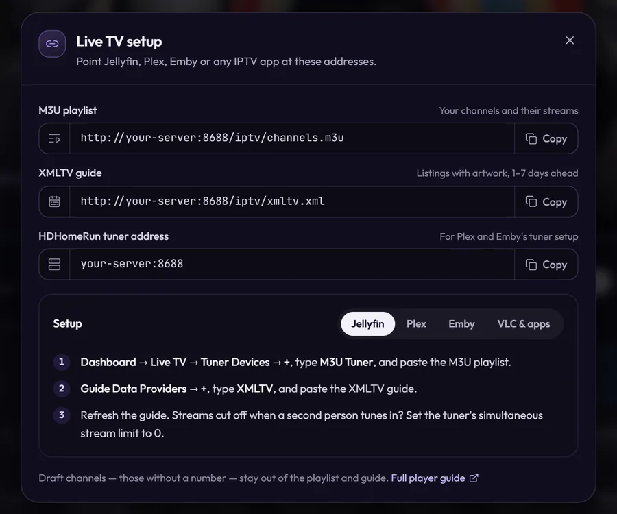

# Connecting Players

MosaicTV speaks the two standards every IPTV-capable player understands:

- **M3U playlist** — `http://YOUR-SERVER:8688/iptv/channels.m3u`
- **XMLTV guide (EPG)** — `http://YOUR-SERVER:8688/iptv/xmltv.xml`

Both — plus the HDHomeRun tuner address Plex and Emby use — are one click
away under **Live TV setup**, the link button at the foot of the side rail
(under **More** on a phone), with copy buttons and the steps for each player:

Tune in mid-program and a channel picks up at the right spot, just like real
TV. Only channels with a **number** are listed — drafts stay out.

Watching in the browser instead, or casting to a TV from it? That's TV mode:
see [Watching](watching.md#casting).

---

## Streaming mode (shared HLS vs MPEG-TS)

**Settings → Streaming → Stream format** decides which URL the M3U hands your players. Both
endpoints are always live — this only changes what the playlist advertises.

| Mode | URL | One transcode per… |
| ---- | --- | ------------------ |
| **MPEG-TS** (default) | `/iptv/channel/<number>.ts` | **viewer** |
| **Shared HLS** | `/iptv/channel/<number>/index.m3u8` | **channel** |

**Pick shared HLS if more than one person watches at a time.** A channel runs a
single encoder that writes rolling segments, and every viewer reads the same
ones — so three people on one channel cost one transcode instead of three. The
encoder starts on the first request and shuts down 30 seconds after the last
viewer leaves, so idle channels still cost nothing.

MPEG-TS remains the default and is the better fit for a single viewer or a
player that dislikes HLS: it's a continuous stream with no segment latency.

> While a shared-HLS channel is warming up (a second or two), the playlist
> returns **503** and players retry automatically. A channel with nothing
> scheduled returns **409**.

---

## Jellyfin

1. **Dashboard → Live TV → Tuner Devices → +**
   - Type: **M3U Tuner**
   - URL: `http://YOUR-SERVER:8688/iptv/channels.m3u`
2. **Guide Data Providers → +**
   - Type: **XMLTV**
   - URL: `http://YOUR-SERVER:8688/iptv/xmltv.xml`
3. Refresh the guide. Channels appear under **Live TV** with full listings.

> **Streams stop when a second person tunes in?** Raise *Simultaneous stream
> limit* on the tuner (0 = unlimited). MosaicTV happily serves multiple
> clients; it's the tuner setting that cuts them off.

## Emby

Same shape as Jellyfin: **Live TV** → add an **M3U** tuner with the playlist
URL, add an **XMLTV** guide source with the guide URL, refresh guide data.

Emby also accepts MosaicTV as an **HDHomeRun** tuner — add one pointed at
`YOUR-SERVER:8688` (entered by hand; there's no broadcast discovery) and pair
it with the XMLTV guide source. Either route works; the M3U one is simpler.

## Plex

Plex's Live TV wants a HDHomeRun-style tuner, not a raw M3U — MosaicTV
emulates one natively, so no Threadfin/xTeVe is required.

1. **Settings → Live TV & DVR → Set Up Plex DVR**. MosaicTV does **not**
   answer broadcast scans, so it will never appear in the device list on its
   own — click **"Don't see your HDHomeRun? Enter its network address
   manually"** and give it `YOUR-SERVER:8688`.
2. Plex reads `http://YOUR-SERVER:8688/discover.json` and `/lineup.json` to
   pull in the channel list, then finishes setup with the guide from the
   XMLTV URL above.

**Settings → Streaming → HDHomeRun tuner** holds what the tuner reports (a
**Copy** button beside the address):

- **Address** — the `host:port` to give Plex, with a copy button (the address
  the page is open on; use another if Plex reaches MosaicTV differently).
- **Device ID** — generated once per instance, read-only. Plex identifies the
  tuner by this, so a new one would register as a second, unrelated tuner.
- **Name** — what Plex lists the device as. Worth changing if you run
  more than one instance, since both otherwise appear as "MosaicTV". Plex may
  keep showing the old name until the DVR entry is re-added.
- **Tuners** — how many simultaneous streams the tuner advertises
  (default 4). Raise it if playback gets cut off when another person tunes in;
  Plex stops at the tuner count, not at any real MosaicTV limit.

> **The tuner always serves MPEG-TS**, whatever *Stream format* is set to. A
> tuner URL is a raw transport stream by contract, and Plex fails to tune —
> *"could not tune into your channel, check antenna"* — if handed an HLS
> playlist. Shared HLS still applies to the M3U; Plex just costs one
> transcode per viewer.

Threadfin/xTeVe still work as a middle layer if you want their extra
features (channel remapping, filtering) — point them at the M3U/XMLTV URLs
above the same as before.

## VLC / IINA / mpv

Open the M3U URL directly (**Media → Open Network Stream** in VLC) — you get
the full channel list with logos. Or open a single channel's `.ts` URL.

## TiviMate / IPTV Smarters / other IPTV apps

Add a playlist by URL using the M3U link, and the EPG using the XMLTV link.
Works on Android TV / Fire TV boxes on your LAN.

---

## Away from home

With [sign-in](security.md) on, a player outside your home network uses
**links of its own** — an M3U, an XMLTV guide and a tuner address with a key
in the path — from **Settings → Sign-in → Player links**. They reach the
channels and their guide and nothing else, and removing the player turns them
off.

## Notes

- **Guide logos** come from each channel's assigned logo ([Branding](branding.md)).
- **Posters and episode details** — each program's picture, episode name,
  description and dates — are in the XMLTV guide too, for players that show
  them.
- **Channel groups** (the Group field) map to M3U `group-title`, which most
  players use to categorize channels.
- **Draft channels** (no number) are excluded from the playlist, guide, and
  streams.
- The URLs honor reverse-proxy headers (`X-Forwarded-Proto`/`Host`), so links
  inside the M3U/XMLTV stay correct behind a proxy.
