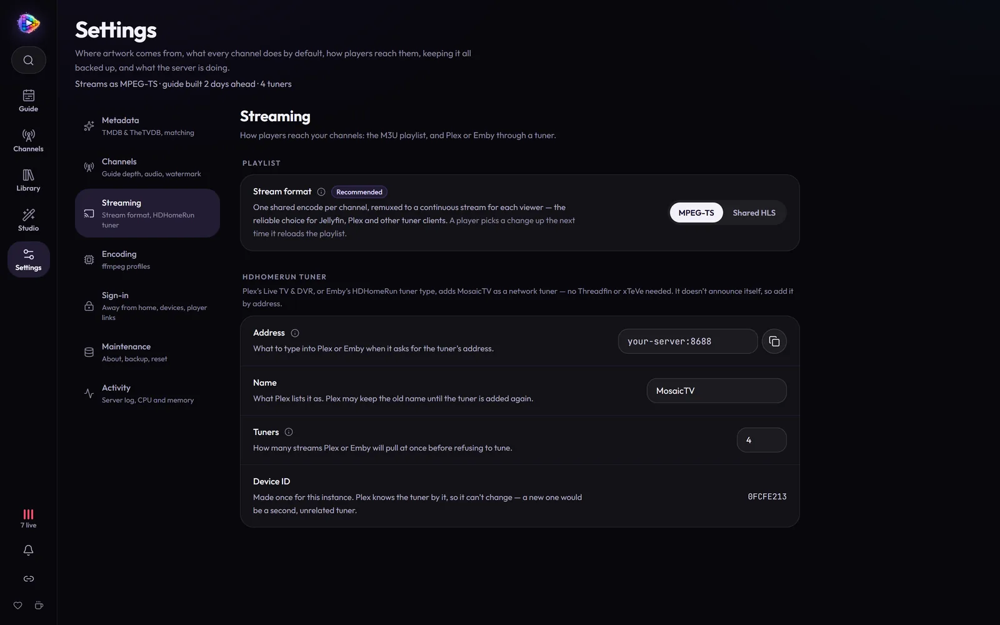

# Connecting Players

MosaicTV speaks the two standards every IPTV-capable player understands:

- **M3U playlist** — `http://YOUR-SERVER:8688/iptv/channels.m3u`
- **XMLTV guide (EPG)** — `http://YOUR-SERVER:8688/iptv/xmltv.xml`

(Both URLs — plus the HDHomeRun tuner address — are one click away under
**Live TV setup**, the link icon at the bottom of the rail (in **More** on a
phone), with copy buttons and per-player steps.)

Tune in mid-program and a channel picks up at the right spot, just like real TV.

## Casting from TV mode

**Watch** (TV mode — see [Watching](watching.md)) has a **Cast** button over
the picture. Once a TV is playing, TV mode is its remote: flip channels and the
TV follows.

- **Chrome / Edge → Chromecast or Google TV.** Chrome only allows casting from
  a page opened over **HTTPS** (or `localhost`), so it works once MosaicTV is
  served over HTTPS — Tailscale's `tailscale serve` or a reverse proxy with a
  real certificate both do it. The TV plays the channel's stream itself, so it
  must be able to reach that same address. On plain `http://` the button
  explains this instead; Chrome's own menu (⋮ → Cast…) can still mirror the tab.
- **Safari → AirPlay.** No HTTPS needed; TV mode plays Safari's native
  stream so it can be handed to an Apple TV.

---

## Streaming mode (shared HLS vs MPEG-TS)

**Settings → Streaming → Stream format** decides which URL the M3U hands your players. Both
endpoints are always live — this only changes what the playlist advertises.

| Mode | URL | What a viewer gets |
| ---- | --- | ------------------ |
| **MPEG-TS** (default, recommended) | `/iptv/channel/<number>.ts` | A continuous stream, copied from the channel's one encode |
| **Shared HLS** | `/iptv/channel/<number>/index.m3u8` | The channel's HLS segments, read straight off disk |

**Either way, a channel is encoded once, however many people watch it.** Each
channel runs a single encoder that writes rolling segments; it starts on the
first request and stops 30 seconds after the last viewer leaves, so idle
channels cost nothing.

- **MPEG-TS** wraps those segments into a continuous stream for each viewer —
  a light copy, not another encode. It's the reliable choice for Jellyfin,
  Plex and other tuner clients.
- **Shared HLS** hands players the segments themselves — the lightest of all
  when many people watch at once, or behind a CDN. Players that don't follow
  the live edge (Jellyfin, Plex) can freeze on the sliding window, so keep
  them on MPEG-TS.

TV mode in the browser always plays HLS.

> While a shared-HLS channel is warming up (a second or two), the playlist
> returns **503** and players retry automatically. A channel with nothing
> scheduled returns **409**.

---

## Jellyfin

1. In Jellyfin: **Dashboard → Live TV → Tuner Devices → +**
   - Type: **M3U Tuner**
   - URL: `http://YOUR-SERVER:8688/iptv/channels.m3u`
2. **Guide Data Providers → +**
   - Type: **XMLTV**
   - URL: `http://YOUR-SERVER:8688/iptv/xmltv.xml`
3. Refresh the guide. Channels appear under **Live TV** with full listings.

> **Streams stop when a second person tunes in?** Raise *Simultaneous stream
> limit* on the tuner (0 = unlimited). MosaicTV happily serves multiple
> clients; it's the tuner setting that cuts them off.

## Emby

Same shape as Jellyfin: **Live TV** → add an **M3U** tuner with the playlist
URL, add an **XMLTV** guide source with the guide URL, refresh guide data.

Emby also accepts MosaicTV as an **HDHomeRun** tuner — add one pointed at
`YOUR-SERVER:8688` (entered by hand; there's no broadcast discovery) and pair
it with the XMLTV guide source. Either route works; the M3U one is simpler.

## Plex

Plex's Live TV wants a HDHomeRun-style tuner, not a raw M3U — MosaicTV
emulates one natively, so no Threadfin/xTeVe is required.

1. **Settings → Live TV & DVR → Set Up Plex DVR**. MosaicTV does **not**
   answer broadcast scans, so it will never appear in the device list on its
   own — click **"Don't see your HDHomeRun? Enter its network address
   manually"** and give it `YOUR-SERVER:8688`.
2. Plex reads `http://YOUR-SERVER:8688/discover.json` and `/lineup.json` to
   pull in the channel list, then finishes setup with the guide from the
   XMLTV URL above.

**Settings → Streaming → HDHomeRun tuner** holds what the tuner reports:

- **Address** — the `host:port` to give Plex, with a copy button (the address
  the page is open on; use another if Plex reaches MosaicTV differently).
- **Device ID** — generated once per instance, read-only. Plex identifies the
  tuner by this, so a new one would register as a second, unrelated tuner.
- **Name** — what Plex lists the device as. Worth changing if you run
  more than one instance, since both otherwise appear as "MosaicTV". Plex may
  keep showing the old name until the DVR entry is re-added.
- **Tuners** — how many simultaneous streams the tuner advertises
  (default 4). Raise it if playback gets cut off when another person tunes in;
  Plex stops at the tuner count, not at any real MosaicTV limit.

> **The tuner always serves MPEG-TS**, whatever *Stream format* is set to. A
> tuner URL is a raw transport stream by contract, and Plex fails to tune —
> *"could not tune into your channel, check antenna"* — if handed an HLS
> playlist. Shared HLS still applies to the M3U; Plex gets the same one encode
> per channel, copied.

Threadfin/xTeVe still work as a middle layer if you want their extra
features (channel remapping, filtering) — point them at the M3U/XMLTV URLs
above the same as before.

## VLC / IINA / mpv

Open the M3U URL directly (**Media → Open Network Stream** in VLC) — you get
the full channel list with logos. Or open a single channel's `.ts` URL.

## TiviMate / IPTV Smarters / other IPTV apps

Add a playlist by URL using the M3U link, and the EPG using the XMLTV link.
Works on Android TV / Fire TV boxes on your LAN.

---

## Notes

- **Guide logos** come from each channel's assigned logo ([Branding](branding.md)).
- **Channel groups** (the Group field) map to M3U `group-title`, which most
  players use to categorize channels.
- **Draft channels** (no number) are excluded from the playlist, guide, and
  streams.
- The URLs honor reverse-proxy headers (`X-Forwarded-Proto`/`Host`), so links
  inside the M3U/XMLTV stay correct behind a proxy.
