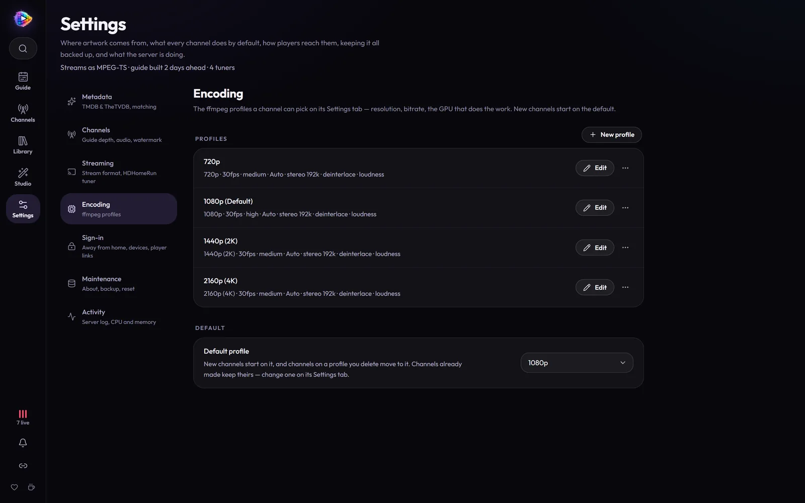

# Hardware Acceleration

MosaicTV transcodes every channel to a consistent format so streams are
seamless. That encoding can run on the **CPU** (works everywhere, default) or
on a **GPU** from any of the major vendors (much lower CPU load).

| Hardware accel | Encoder | Platform |
| -------------- | ------- | -------- |
| **CPU** (default) | libx264 | anywhere |
| **NVIDIA** | h264_nvenc | Nvidia GPUs |
| **Intel QuickSync** | h264_qsv | Intel 11th-gen Core, Arc and newer |
| **VAAPI** | h264_vaapi | Intel (any with an iGPU) and AMD on Linux |
| **AMD AMF** | h264_amf | AMD GPUs, with AMD's own driver stack — outside Docker |
| **Apple** | h264_videotoolbox | macOS, outside Docker |

The Docker image carries the Intel and AMD drivers VAAPI and QuickSync need;
in it, an AMD card encodes through VAAPI.

Choose one per encoding profile under **Settings → Encoding**, or leave it on
**Auto**.

**It's self-validating.** Support is confirmed at runtime by actually encoding a
tiny sample with the chosen encoder on *your* host — not just by asking whether
ffmpeg lists it (many builds list `h264_qsv`/`h264_amf` even with no matching
GPU). If the encoder doesn't genuinely work, MosaicTV logs a warning and falls
back to the CPU (libx264), so a wrong choice or a missing GPU never breaks the
stream. **Auto** probes in order (NVENC → QSV → VAAPI → AMF → VideoToolbox) and
picks the first that works, else CPU.

GPU **decoding** currently accelerates on **NVIDIA (NVDEC)** only, probed per
codec; other vendors decode on the CPU and encode on the GPU (encoding is the
bigger win). 

> **VAAPI render node:** defaults to `/dev/dri/renderD128`. If yours differs,
> set the `VAAPI_DEVICE` environment variable. Pass the device into the
> container (`--device /dev/dri:/dev/dri`).

## Hardware requirements

A channel is encoded only **while someone is watching it**, and everyone
watching the same channel shares one encode. So size the server by **how many
different channels are watched at the same time** — not by how many channels
you build, or how many people watch.

| | Light | Recommended | Heavy |
| - | ----- | ----------- | ----- |
| **Channels watched at once** | 1–2 | 3–5 | 6 or more |
| **CPU** | 4 cores, from about 2015 on | 4–6 cores | 6–8 cores |
| **GPU** | None — CPU encoding, on the 720p profile | Any GPU from the table above; NVIDIA GTX 1050 or newer if your files are mostly HEVC (x265) | NVIDIA RTX |
| **RAM** | 4 GB | 8 GB | 16 GB, to keep live segments in RAM |

Every server also needs:

- **A 64-bit Intel or AMD (amd64) Docker host.** There's no ARM image yet —
  see [Installation](install.md).
- **An SSD for `/app/data`, with about 10 GB free.** A large library uses 1–2
  GB for the database, artwork and caches; backups and live segments need the
  rest. Your media can live anywhere, network shares included. To spare the
  SSD, put the segments [in RAM](install.md#live-segments-in-ram-optional).
- **A wired network connection for the server.** Each viewer pulls about
  2.5 / 5 / 8 Mbps at 720p (the **Low** / **Medium** / **High** quality
  settings), and about 5.5 / 11 / 18 Mbps at 1080p, with peaks up to 1.6×
  that. Viewers outside your home use your upload at the same rates.

### What makes a channel expensive

**Decoding the source file often costs more than encoding the channel.** HEVC
(x265) and AV1 files are much heavier to decode than H.264, and 1080p or 4K
far heavier than SD. MosaicTV decodes on the GPU on **NVIDIA only** — Intel and
AMD encode on the GPU but decode on the CPU — so a library of HEVC files is
where an NVIDIA card helps most.

- Some older NVIDIA cards (the GTX 970, for one) can't decode HEVC; the GTX 10
  series and newer all can. AV1 decoding needs an RTX 30 series or newer.
- The **GT 1030** has no video encoder at all — it can't encode a channel.
- GeForce cards cap how many encodes can run at once. That only matters if
  you'll have many channels on air together.

Measured on a 4-core i7-4790K with a GTX 970 encoding (NVENC), 1080p output:

| Source | Decoded on | CPU | RAM |
| ------ | ---------- | --- | --- |
| SD H.264 (640×480) | GPU | 0.3 core | 310 MB |
| A song over a still picture | – | 0.2 core | 250 MB |
| 1080p HEVC, 10-bit | CPU (the GTX 970 can't decode HEVC) | 2.4 cores | 630 MB |

The whole container used 1.3 GB of RAM with those three on air. With no GPU
at all, budget roughly 1–1.5 cores per channel at 720p from H.264 files, and
3–4 cores per channel at 1080p (the default profile) from HEVC files — so a
CPU-only server is happiest with its channels on the 720p profile.

---

## NVIDIA setup

### Unraid

1. Install the **Nvidia-Driver** plugin (Community Apps) and reboot as prompted.
2. Edit the MosaicTV container:
   - **Extra Parameters**: add `--runtime=nvidia`
   - **NVIDIA GPUs** (`NVIDIA_VISIBLE_DEVICES`): `all`, or one GPU's UUID from
     `nvidia-smi -L` to pin a specific card
   - **NVIDIA Capabilities** (`NVIDIA_DRIVER_CAPABILITIES`): `all`
3. Apply. Check **Settings → Activity** in MosaicTV — streams should mention `h264_nvenc`.

### docker run

Requires the [NVIDIA Container Toolkit](https://docs.nvidia.com/datacenter/cloud-native/container-toolkit/latest/install-guide.html)
on the host:

```bash
docker run -d ... \
  --gpus all \
  -e NVIDIA_VISIBLE_DEVICES=all \
  -e NVIDIA_DRIVER_CAPABILITIES=all \
  ghcr.io/tronvondoom/mosaictv:latest
```

### Docker Compose

Uncomment the NVIDIA lines in `docker-compose.yml`:

```yaml
    runtime: nvidia
    environment:
      - NVIDIA_VISIBLE_DEVICES=all
      - NVIDIA_DRIVER_CAPABILITIES=all
```

---

## Intel and AMD setup

The image has the drivers; the container just needs the GPU passed in. On the
host, the GPU shows up as `/dev/dri` (if that folder isn't there, its driver
isn't loaded — on Unraid, the **Intel GPU TOP** plugin loads it for an Intel
iGPU).

- **Unraid:** edit the container and add `--device=/dev/dri` to **Extra
  Parameters**.
- **docker run:** add `--device /dev/dri:/dev/dri`.
- **Docker Compose:** uncomment the `devices:` lines in `docker-compose.yml`.

Leave the profile's **Hardware** on **Auto**: it tries QuickSync first (11th-gen
Core, Arc and newer), then VAAPI (older Intel, and AMD). Check **Settings →
Activity** — streams should mention `h264_qsv` or `h264_vaapi`. A host with more than one
GPU may need `VAAPI_DEVICE` set to the right render node (see above).

---

## Encoding profiles

**Settings → Encoding** holds the profiles — how a channel is encoded: its
picture size, frame rate, quality and the GPU that does the work — and each
channel picks one on its **Settings** tab.



Four come ready-made — **720p**, **1080p**, **1440p (2K)** and **2160p (4K)**,
all 30 fps, medium quality, the GPU when there is one, and loudness evened out
from one program to the next. **1080p is the default**, labelled
"1080p (Default)": new channels start on it, it can't be deleted, and deleting
any other profile moves its channels onto it. Pick another default under
**Default profile**. Each ready-made profile is added once, so one you delete
stays deleted.

**New profile** makes your own; click one to edit it:

| Setting | What it does |
| ------- | ------------ |
| **Resolution / Frame rate** | Output size and frame rate for the whole channel |
| **Scaling** | How a picture of another shape is fitted: **Scale and pad** (black bars, nothing lost), **Scale and crop**, or **Stretch** |
| **Hardware acceleration** | **Auto** (GPU if present), a vendor (NVIDIA, QSV, VAAPI, AMF, VideoToolbox — warns and falls back if missing), or **CPU** (force libx264) |
| **Preset** | Encoder speed/quality trade-off (`veryfast`… for x264, `p1`–`p7` for NVENC) |
| **Quality** | Low / Medium / High: a bitrate ladder scaled by resolution (at Medium, about 16 Mbps at 1440p and 26 at 4K) |
| **Bitrate / Buffer** | An explicit rate in place of the quality ladder |
| **Deinterlace** | For older, interlaced content |
| **Burn in subtitles** | Render the source's first embedded subtitle track into the picture |
| **Audio bitrate / channels** | AAC output settings |
| **Normalize loudness** | Even out volume across different sources |
| **Threads** | CPU thread cap for the encoder |

> **Burn-in** is the only way to get subtitles onto a live channel — there's no
> track for a player to switch on, because every viewer receives the same
> encoded picture. It applies to programs (never breaks) and only when the file
> actually has a subtitle stream, so it costs nothing on sources without one.

A practical split: the ready-made **1080p** for your main channels and **720p**
for background or break-heavy ones — or for every channel on a server with no
GPU.
