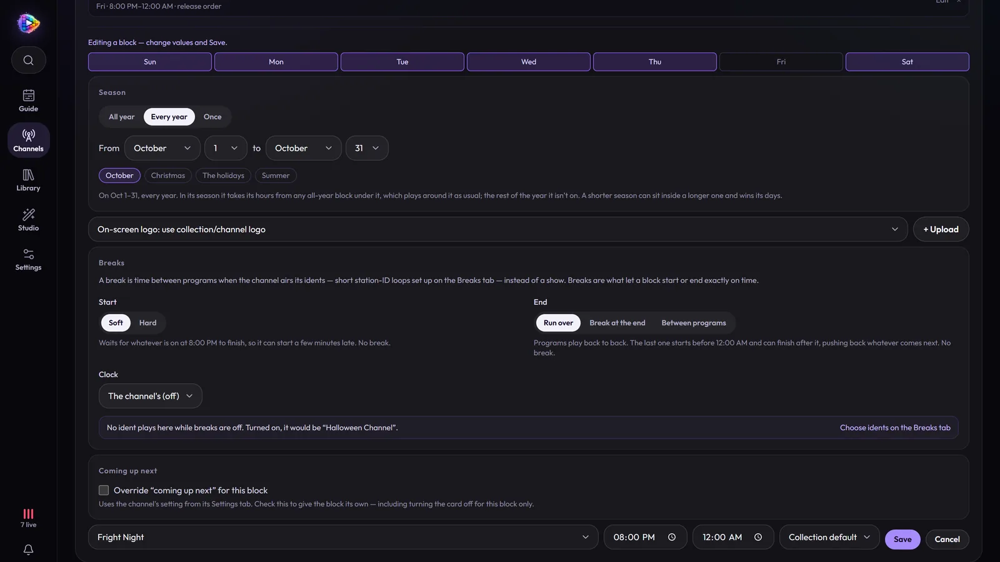

# How-tos

Recipes for the channels people actually want to build, step by step, with
the screens you'll see. Each one links to the full reference when you want
the details.

**Building channels**

- [Make a channel in three steps](#make-a-channel-in-three-steps)
- [Play two episodes, then a movie](#play-two-episodes-then-a-movie)
- [Add a Saturday-morning block](#add-a-saturday-morning-block)
- [Rebuild a network's day: daytime, prime time, overnight](#rebuild-a-networks-day)
- [Air cartoons as the half-hours they aired as](#air-cartoons-as-the-half-hours-they-aired-as)
- [Start every show on the :00 and :30, with commercial breaks](#start-every-show-on-the-00-and-30-with-commercial-breaks)
- [Run a block only in October (or at Christmas)](#run-a-block-only-in-october-or-at-christmas)
- [Keep Christmas episodes for Christmas](#keep-christmas-episodes-for-christmas)
- [Air specials and extras on one channel only](#air-specials-and-extras-on-one-channel-only)
- [Make a music channel](#make-a-music-channel)
- [Make a guide channel](#make-a-guide-channel)

**Making it look like TV**

- [Put your logo in the corner](#put-your-logo-in-the-corner)
- [Change what plays in the breaks](#change-what-plays-in-the-breaks)
- [Fill breaks with your old bumpers and commercials](#fill-breaks-with-your-old-bumpers-and-commercials)
- [Promote what's on later ("Tonight at 8")](#promote-whats-on-later)
- [Pick an up-next card](#pick-an-up-next-card)

**Watching and running it**

- [Watch on your TV through Plex, Jellyfin or an IPTV app](#watch-on-your-tv)
- [Watch away from home](#watch-away-from-home)
- [Fix a wrong poster or title](#fix-a-wrong-poster-or-title)
- [Use your GPU](#use-your-gpu)
- [Back up, and restore](#back-up-and-restore)

---

## Make a channel in three steps

1. **Channels → New channel.**
2. **Name it.** Give it a name, and a number if you're ready (without one it
   stays a draft, out of your players' guide). Pick a group and a logo if you
   like. **Next** saves it, so you can leave and finish it later.
3. **Pick what it plays.** Tap the posters of the shows, movies or artists
   it should play. The preview on the right adds up how long it all runs —
   how much it has before anything repeats.
4. **Choose when.** **All day** plays the picks around the clock; **In
   blocks** takes you to the channel's Schedule tab to draw the times on the
   week.

That's a channel. The picks become the channel's own **collection**, and
everything here can be changed later on the channel's page. More in
[Getting Started](getting-started.md).

## Play two episodes, then a movie

On the channel's **Schedule** tab, the **Rotation** is the 24/7 backbone: a
list of collections that loops forever.

1. At the foot of the Schedule tab, under **Collections on this channel**,
   make two collections: **+ New** → "Sitcoms" (add the shows), then
   **+ New** → "Movies" (add the movies).
2. Under **Rotation**, pick **Sitcoms**, **multiple**, **2**, **Add**; then
   **Movies**, **1 at a time**, **Add**.

It plays two sitcom episodes, a movie, two more episodes, and so on — each
show carrying on from where it was.
[More on rotations](channels.md#rotation).

## Add a Saturday-morning block

**Time blocks** take over from the rotation at set days and times.

1. On the **Schedule** tab, under **Time blocks**, click the empty slot on
   **Saturday** at **7a**. The block form below the grid opens on that day
   and time.
2. Pick the **Collection** (your cartoons), and the end time — **12:00 PM**.
3. Under **Breaks**:
   - **Start: Hard** — it starts at 7:00 on the dot; whatever was on is saved
     for later, and a station break fills the minutes up to 7.
   - **End: Break at the end** — only cartoons that finish by noon play, and
     the minutes left are one break, so the next block starts on time.
4. Optional: an **On-screen logo** for the block, and its own
   **Coming up next** card.
5. **Add.**

[Soft and hard starts, and ending on time](channels.md#breaks-starting-and-ending-on-time).

## Rebuild a network's day

A real network had dayparts: Nickelodeon by day, Nick at Nite overnight,
SNICK on Saturday night. Each daypart is a collection, and each gets blocks.

1. Make a collection per daypart — **Nickelodeon**, **Nick at Nite**,
   **SNICK** — under **Collections on this channel**, each with its shows.
   Give each its own **Logo** in the collection's **Settings**, and the
   corner logo changes with the daypart.
2. Draw the blocks on the week: *Every day 6:00 AM–8:00 PM → Nickelodeon*,
   *Every day 8:00 PM–6:00 AM → Nick at Nite*, *Saturday 8:00–10:00 PM →
   SNICK* (blocks can cross midnight).
3. Leave the **Rotation** with one collection to fill any hour no block
   claims — or leave it empty, and the time between blocks airs your breaks.

The same idea makes a movie channel with dayparts — a morning of family
films, a matinee, monster hits, and Freddy on Friday nights, in order:

For a block that plays a series in order (Freddy, the Star Wars films), set
the collection's order to **Release order**.

## Air cartoons as the half-hours they aired as

Dexter's Laboratory aired three seven-minute cartoons to a half hour; *2
Stupid Dogs* ran a *Super Secret Secret Squirrel* short between its two dog
cartoons. Your files list each one as an episode. A **broadcast episode**
puts them back together.

1. **Library →** the show **→** a season **→ Group broadcast episodes**.
2. **Suggest groupings**, with a target of **22 minutes** (or 11, 30, or your
   own), packs the season's segments into half hours as a starting point.
3. Fine-tune: tick episodes and **Group selected**, reorder with **↑ ↓**, take
   one out with **×**, **Ungroup** a group.
4. To weave in a short from another show, **+ Add segment** on a group and
   search the whole library for it — *Goldflipper* from *Super Secret Secret
   Squirrel*, say — then move it into place.
5. **Save.**

Every channel that airs the show plays each group as one program, lists it
as one entry in the guide, and gives it one up-next card naming every part.
Nothing on disk changes.
[More on broadcast episodes](channels.md#broadcast-episodes-multi-segment-shows).

## Start every show on the :00 and :30, with commercial breaks

1. On the **Schedule** tab, **Broadcast clock → :00 and :30**. Every program
   now starts on a line of the clock, with a break up to it: a 22-minute
   episode at 7:00 is followed by an 8-minute break, and the next show starts
   at 7:30.
2. Tick **Breaks inside programs**, and that break time is shared out across
   each program's **act breaks** — where it cut to commercial when it aired —
   with the last of it after. Act breaks are found by themselves, from the
   file's chapter marks or its fades to black.

A block can keep its own clock: Cartoon Network's weekday afternoon block
runs on **quarter hours** with breaks inside programs, while the rest of the
channel has none.

[More on the broadcast clock](channels.md#the-broadcast-clock).

## Run a block only in October (or at Christmas)

1. Edit the block (or draw a new one), and under **Season** choose **Every
   year** (or **Once**, for this year only).
2. Pick the dates, or one click: **October**, **Christmas**, **The
   holidays**, **Summer**.
3. **Save.**

In its season the block takes its hours from any all-year block under it,
which plays up to it and picks up again after. Out of season, it isn't there.
A shorter season inside a longer one wins its days, so a Halloween-night
block can sit inside an October of movies.
[More on seasons](channels.md#seasons-blocks-for-part-of-the-year).

## Keep Christmas episodes for Christmas

On the **Schedule** tab, turn on **Holiday episodes in their season**.
Christmas episodes then air from late November to New Year, Halloween ones in
October, Thanksgiving ones in November — and Valentine's, St. Patrick's,
Easter, New Year's and the Fourth of July in theirs. An episode counts when
its title names the holiday (*A Rugrats Christmas*, *Treehouse of Horror*).
The schedule notes at the top of the tab count yours and turn it on in one
click.

## Air specials and extras on one channel only

Specials (season 0) and extras (featurettes, trailers) are off on every
channel to start with.

1. On the channel's **Schedule** tab, under **Collections on this channel**,
   the note under the list says whether whole shows and movies bring in
   **Specials** and **Extras** — switch them on for this channel.
2. One show different? Its tile in the collection has its own **Specials**
   and **Extras** switch.

[More on specials and extras](channels.md#specials-and-extras).

## Make a music channel

1. **Library → Sources → Add a library**, type **Music (songs)**, point it at
   your music, **Scan**. Switch on **MusicBrainz** and **LRCLIB** under its
   **Metadata** for covers, years and synced lyrics.
2. **Channels → New channel**, and on **Pick what it plays** choose the
   **Music** shelf and tap artists.
3. On the channel's **Settings** tab, under **Music**, pick the **Now
   playing screen** — **Album** or **Visualizer** — and **If lyrics exist,
   show lyrics first** for a karaoke-style screen.
4. For a station of forty artists that plays one song from each in turn, set
   the collection's order to **Take turns**.

In the guide a run of songs is one block an hour, named after its collection.
[More on music channels](channels.md#music).

## Make a guide channel

Players that can only tune channels (Plex, IPTV apps, a TV with no guide)
can still see what's on.

1. **Channels → New channel**: name it, give it a number, and **Finish
   later** — it needs no programs of its own.
2. On its **Settings** tab, under **Picture**, choose **The guide**, and a
   **Look**: **Classic** (the blue cable guide) or **Mosaic**.
3. Optional: give it some songs on its Schedule tab, and they play
   underneath.

## Put your logo in the corner

1. **Studio → Logos → Upload logo** (a PNG with transparency looks best).
2. On the channel's **Settings** tab, pick it as the **Logo**. It's the
   channel's icon in your players' guide, and the corner logo on screen.
3. To change how it sits — corner, size, see-through, always on or every few
   minutes — click it in **Studio → Logos** and set its **watermark**, with a
   live preview over a frame from your library.

A collection or a block can have its own logo, which takes over while it's
on air. [More on logos and watermarks](branding.md#logos).

## Change what plays in the breaks

Every channel starts with a **Mosaic** ident made from its logo. On the
channel's **Breaks** tab:

1. **New ident**, and pick a look: **Mosaic**, **Frosted glass**, **Your own
   clip**, or **Clips from a folder**.
2. Pick its logo (**Follow the block**, so one ident is right in every block)
   and, if you like, music from **Studio → Music**.
3. Choose where it plays: **Everywhere else**, or **Only during certain
   blocks** — a Nick at Nite ident for the Nick at Nite blocks.
4. **Play preview** shows six seconds of it with the real logo and music.

[More on breaks and idents](branding.md#station-breaks).

## Fill breaks with your old bumpers and commercials

1. Put the clips in a folder on your media share — bumpers, promos, old
   commercials.
2. On the **Breaks** tab, **New ident → Clips from a folder**, and pick the
   folder.

Each break plays a fresh mix of them with their own sound, and Mosaic covers
whatever time they don't fill. **Look again** picks up clips added since.

## Promote what's on later

On the **Breaks** tab, under **Promos**, pick how often a break ends on one:
**Every break**, **1 in 2**, **1 in 3** or **1 in 5**. A promo is twelve
seconds of a program's backdrop and poster with when it's on — *Tonight at
8*, *Saturday at 9 AM* — picked from the guide as the break airs. The tab
shows the promo a break would end on now.

## Pick an up-next card

On the channel's **Settings** tab, under **Coming up next**, tick **Show an
"up next" card over programs** and pick a **Style**: **Art banner**, **Logo
bar**, **Snipe**, **Preview** or **Coming up** — then where, how big, and
when. The preview above it is your channel's actual next program, drawn as it
will air.

A block can have its own, or none: edit the block → **Coming up next →
Override**. [More on up-next cards](branding.md#up-next-cards).

## Watch on your TV

Click **Live TV setup** (the link icon at the bottom of the rail): it has
your addresses with copy buttons and steps for each player.

- **Jellyfin / Emby** — add an **M3U tuner** with the M3U address and an
  **XMLTV** guide with the guide address.
- **Plex** — **Live TV & DVR → Set up**, then *enter its network address
  manually* and give it MosaicTV's address: it's a built-in HDHomeRun tuner.
- **TiviMate, VLC, any IPTV app** — the M3U and XMLTV addresses.

[Player-by-player instructions](clients.md).

## Watch away from home

The easy way: **Tailscale** (or any VPN) on the server and your devices, and
use the server's Tailscale address — it works exactly as at home.

Or turn on **sign-in**: **Settings → Sign-in**, set a password, turn on **Ask
who you are**. Home still gets straight in; anything from outside signs in
with the password or a code you approve, and players get **Player links** of
their own. [More on security](security.md).

## Fix a wrong poster or title

1. Open the movie or show in the **Library**, **⋯ → Fix match**.
2. Search by title and year, or paste a TMDB, TheTVDB or IMDb link, and pick
   the right one.

To find the ones that need it, the library's filter has **Unmatched** and
**Check matches**, with **Fix them one by one**.
[More on matching](library.md#fixing-a-wrong-match).

## Use your GPU

1. Pass the GPU into the container: `--gpus all` for NVIDIA (with the NVIDIA
   container toolkit, or Unraid's Nvidia-Driver plugin), `--device /dev/dri`
   for Intel or AMD.
2. That's it: the ready-made profiles under **Settings → Encoding** use the
   GPU when there is one, and MosaicTV checks it with a real test encode.
   **Settings → Activity** logs `Video encoder selected: …`.

[More on hardware acceleration](hardware-acceleration.md).

## Back up, and restore

- **Settings → Maintenance → Download a backup** saves your libraries,
  channels, settings and uploads in one `.tar.gz`.
- **Settings → Maintenance → Restore a backup** puts it all back.

MosaicTV also copies its database before any upgrade that changes it.
[More on backups](troubleshooting.md#backup--restore).
