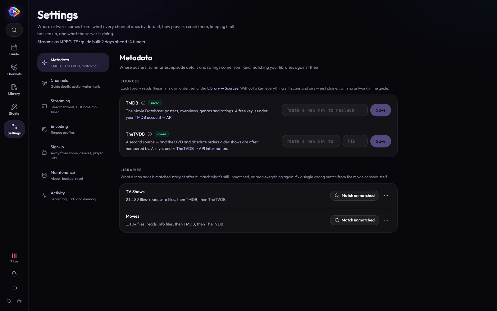
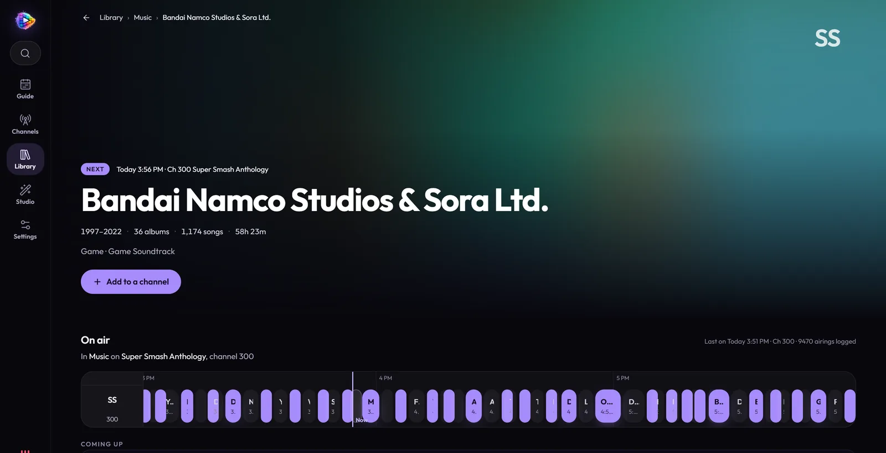
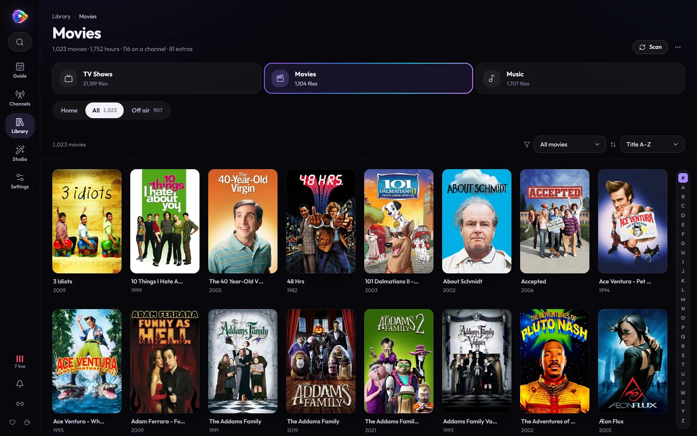

# Your Library

Everything a channel plays comes from your **Library**: TV shows, movies,
music videos and songs, indexed from your folders (or read from a Plex,
Jellyfin or Emby server) and dressed with artwork and details the way Plex
does it. This page covers adding libraries, naming, scanning, metadata,
fixing matches, and the pages each title gets.


- [Adding a library](#adding-a-library)
- [Naming your files](#naming-your-files)
- [Scanning](#scanning)
- [Metadata: posters, details and logos](#metadata-posters-details-and-logos)
- [Fixing a wrong match](#fixing-a-wrong-match)
- [Specials and extras](#specials-and-extras)
- [Music](#music)
- [From Plex, Jellyfin or Emby](#from-plex-jellyfin-or-emby)
- [Browsing: the library, title pages and Add to a channel](#browsing)

---

## Adding a library

**Library → Sources → Add a library.**

- **Name** — whatever you like ("TV Shows", "Movies", "Cartoons").
- **Type** — **TV Shows**, **Movies**, **Music Videos**, **Music (songs)** or
  **Other**. It decides how names are read.
- **Folders** — one or more folders *inside the container*, under `/media`.
  If your host's `/mnt/user/media` is mounted as `/media`, then the host
  folder `/mnt/user/media/tv` is `/media/tv` here. The folder picker only
  browses under `/media`.


Everything in the folders is indexed, as in Plex — season 0 (shown as
**Specials**) and **extras** too (see [Specials and extras](#specials-and-extras)).

A **`.plexignore`** file is honoured the way Plex reads it: one pattern a line
(`#` for a comment), relative to the folder it's in — `*.wav`, `Extras/*` —
with `*` and `?` standing for characters of one name. A folder a pattern
matches is left out whole, so a `.plexignore` holding just `*` keeps its
folder out of the library. Files it leaves out that were indexed before go at
the next scan.

## Naming your files

MosaicTV expects Plex-style naming, which you likely already have:

```
TV/Show Name (2005)/Season 01/Show Name - S01E01 - Episode Title.mkv
Movies/Movie Name (1999)/Movie Name (1999).mkv
```

- A show is its **folder name and year**: `Scrubs (2001)` and `Scrubs (2026)`
  are two shows, the revival titled with its year. A folder with no year, or
  the same year, joins the show of its name, so `Gargoyles (x264)` stays
  with `Gargoyles (1994)`.
- An id in a folder name pins the match, as in Plex and Jellyfin:
  `The Matrix (1999) {tmdb-603}`, `{imdb-tt0133093}`,
  `The Office {tvdb-73244}`, `[tmdbid-603]`. The id is left out of the title.

**Music Videos** read artist and track from the folders — any of these work:

```
Music/Artist/Album/Title.mkv
Music/Artist/Title.mkv
Music/Artist - Title.mkv
```

A music video's title comes off its name without the YouTube noise —
"(Official Music Video)", "[4K]", yt-dlp's `[id]`, a repeated "Artist - ".
Its picture is its own (`<video>.jpg`), else its album folder's cover, else the
cover inside the file (as yt-dlp and Pinchflat embed them); an `artist.jpg` in
the artist's folder pictures the artist. A music-video channel shows a
**Now playing** card naming the track as each one starts, and its guide
entries read "Artist – Title" with the album as the sub-title.

**Music** (songs) — MP3, FLAC, M4A/AAC, Ogg, Opus, WAV, WMA, AIFF and the
like — goes by each song's own tags first (title, artist, album, year, track,
disc), then by its folders and name:

```
Music/Artist/Album/03 - Title.flac
Music/Artist - Title.mp3
```

More in [Music](#music) below.

## Scanning

A library is scanned as soon as it's added. After that, press **Scan** on a
library, or **Scan all** at the top of the Library page
to scan every library one after another ("Scanning 2 of 5"). A progress bar
follows the files as they're probed (length, resolution and codecs, through
ffprobe) and filed into shows, seasons and episodes, and the notification
bell follows it from any page.

- **Re-scans are quick.** Unchanged files are skipped.
- **Deleted files go.** Files gone from disk are removed, as in Plex — but
  not while their folder can't be read: a share that isn't mounted looks like
  every file in it gone, so those wait, hidden, for a scan that can read it.
- **The library follows the scan.** New titles turn up where they sort and
  removed ones go, on the grid and on any open show, movie or artist page — no
  refresh, and the page stays where you'd scrolled. Posters and names a
  metadata fetch brings in arrive the same way.

A library's **⋯** menu (on its page and under **Sources**) has the rest:
**Force rescan** (read every file again, from scratch), **Match unmatched**,
and **Refresh all metadata** (read everything again from the library's
sources, keeping the matches you fixed by hand).

## Metadata: posters, details and logos

Like Plex's agents, each library reads its metadata from a list of sources,
first to last — the first to give a detail wins, the rest fill in what it
doesn't. Set them under **Library → Sources**, on the library's
**Metadata** row (**Read earlier** / **Read later** move a source up or down).

- **.nfo files** (on by default) — Kodi and Jellyfin metadata kept beside the
  media: `movie.nfo` or `<movie>.nfo`, `tvshow.nfo`, an episode's own
  `<episode>.nfo`. An .nfo that names a TMDB, IMDb or TheTVDB id matches the
  title by that id.
- **The files' own tags** (off by default) — titles and descriptions written
  into the files. Often left over from a release; worth it if you tag your own.
- **TMDB** (on by default) — **Settings → Metadata** → paste a free
  [TMDB API key](https://www.themoviedb.org/settings/api) → **Save & verify**.
  Every library that reads TMDB looks its titles up straight away, and from
  then on whatever a scan adds is read straight after it.
- **TheTVDB** (on by default, after TMDB) — **Settings → Metadata** → paste a
  [TheTVDB API key](https://thetvdb.com/api-information) (and, for a
  user-supported key, your subscriber PIN) → **Save & verify**. It fills in
  what TMDB doesn't have — titles TMDB has never heard of, a missing summary
  or episode name; move it above TMDB and it goes first. A title matched on
  one is found on the other by the ids the first lists for it.



You get posters, backdrops, summaries, genres, ratings (TV-Y7, PG-13),
taglines, studios and networks, directors and creators, cast, and for every
episode its name, first air date and a still — shown in the Library and sent
in your players' guide data. Local artwork (`poster.jpg`, `folder.jpg`,
Plex/Kodi/Jellyfin naming) comes first when it's there.

**Episode names.** An episode whose file names it keeps that name; one whose
file doesn't (`Show - S01E02.mkv`) takes the name its metadata gives. If a
file names its episode something quite different from a source's episode at
that number — a cartoon split into its segments — that source's details are
left off it rather than showing another episode's.

### Title logos

A show's or movie's **logo** — its name as artwork, like the *All in the
Family* wordmark — stands in for its name on its page, in the Guide's big
"now playing" panel, on the library's **On air now** shelf, on TV mode's
strip, on the up-next cards and in quick look. A title with none keeps its
name as text.

They come from the same sources as posters, in each library's order: TMDB
(English or wordless logos), TheTVDB (its clear logos), and Plex, Jellyfin or
Emby for a library read from one. A logo file beside the media comes first:
`clearlogo.png` or `logo.png` in a show's folder, and for a movie
`<Movie name>-clearlogo.png`, `clearlogo.png` or `logo.png` (PNG or WebP, so
it can be see-through).

### Episode order

As Plex lets a show pick TheTVDB's DVD or absolute order, a show's **⋯** menu
→ **Episode order…** picks one for it: as aired, one of TMDB's episode groups
(DVD, absolute, production — whatever TMDB has for that show) or one of
TheTVDB's orders. Only the episodes' names, dates and pictures follow it; the
files keep their numbers, and so do the schedule and your broadcast episodes.

## Fixing a wrong match

As in Plex: open a movie or show and choose **Fix match** from its **⋯**
menu. Pick the source — TMDB or TheTVDB, numbered in the order the library
reads them — then search it by title and year, or paste a TMDB, TheTVDB or
IMDb link, and pick the right one. A match you pick is kept: refreshing
metadata never searches that source for the title again, and the other source
follows your pick where it lists the title. **Not there** leaves the title
unmatched on that source; **Unmatch** takes every match away for good (home
videos neither source has).

A library's **filter** finds what wants a look:

- **Unmatched** — no source has it.
- **Check matches** — automatic matches whose year is off from the file's by
  more than a year, or whose title doesn't look like it.

**Fix them one by one**, beside the filter's note, opens Fix match on each in
turn: pick one, or **Skip**, and it goes on to the next.

## Specials and extras

Libraries keep everything they find:

- **Specials** — pilots, holiday specials, shorts and promos filed as
  season 0.
- **Extras** — featurettes, trailers, interviews and deleted scenes filed
  with a movie or show: an `Extras`, `Featurettes`, `Trailers`,
  `Behind The Scenes`… folder inside its folder, or a name ending in
  `-featurette`, `-trailer` and so on. A movie's extras are listed with the
  movie, a show's on its page; the library's filter → **Unattached extras**
  finds any with no movie of their own.

Whether they **air** is up to each channel, and both are off to start with —
see [Specials and extras](channels.md#specials-and-extras) in Channels &
Scheduling.

## Music

**Filed by album artist.** Songs are filed under their album's artist, as
Plex and other music apps file them, so an album stays one album whoever sings
each song: a soundtrack tagged *Various Artists* is one album under Various
Artists, a game-music set one album per volume. Each song keeps its own
artist, shown beside it, in the guide and on the now-playing screen. A track
tagged as part of a compilation with no album artist files under Various
Artists; an album with no album-artist tags whose songs credit different
people is still one album. A set whose discs are tagged as albums of their own
("The Ultimate Hits (CD1)") or filed in disc folders (`Album/Disc 2/`) is one
album, its songs by disc.

**Covers and lyrics.** A song's cover is its album folder's (`cover.jpg`,
`folder.jpg`, `front.jpg`) or the one inside the file. Timed lyrics come from
a `.lrc` beside it (`03 - Title.lrc`) or from its tags.

**Looked up online, free.** A Music Videos library reads its Kodi
`<musicvideo>` .nfo files and its videos' own tags; a Music library reads
every song's tags. Either can also switch on, with no key:

- **MusicBrainz** — the album a song is on, the year it first came out, its
  genres, and the album's cover from the Cover Art Archive, for whatever the
  files don't say. It's asked a request a second, as MusicBrainz asks, so a
  big library takes a while the first time; live bootlegs and compilations
  are passed over for the studio album.
- **LRCLIB** (Music libraries) — timed lyrics for songs that have none of
  their own, for the Lyrics screen.

**Browsing.** A Music or Music Videos library is filed as a music app files
it: **Artists** (the default), **Albums**, or every **Song** (or video). An
artist's page shows where they air and their albums as covers, oldest first;
an album opens its own page of songs in order.



How songs air — the now-playing screen, lyrics, hour blocks in the guide — is
in [Music channels](channels.md#music).

## From Plex, Jellyfin or Emby

Already have a Plex, Jellyfin or Emby server that knows your shows? **Read
from → Plex / Jellyfin / Emby** on the **Add a library** card reads its
libraries instead: show names, seasons and episode numbers, episode titles,
descriptions, genres, ratings, dates, artwork and logos. MosaicTV still plays
the files itself, from disk — nothing streams through the server — so the
files have to be mounted where MosaicTV can see them too.

1. **Sign in.**
   - **Plex** — **Sign in with Plex** opens Plex's own sign-in in a new tab.
     Allow it there and come back; MosaicTV never sees your password. It then
     lists your Plex servers and tries each one's addresses itself (at home
     first), keeping the first that answers. If none does, it shows every
     address it tried and what each said.
   - **Jellyfin** — MosaicTV looks for it on your network, on the machine
     you opened MosaicTV on, and on the Docker host; pick it, or type its
     address. Then either **Quick Connect** (MosaicTV shows a code; in
     Jellyfin, open your profile → **Quick Connect** and enter it) or your
     user name and password.
   - **Emby** — found the same way, then your user name and password.

   The sign-in is kept, so the next library from the same server needs none.
   **Sign out** is beside it; libraries already added keep reading.
2. **Tick its libraries** — TV, movies and music. Each one becomes a library
   here, named as on the server (change it if you like). One that's already
   here says so.
3. Check **where its folders are here**: the server sees its files at its own
   paths (`/data/tv`, `D:\TV`); each needs pointing at the same folder inside
   MosaicTV. Where it can tell, MosaicTV fills these in — the folder under
   `/media` whose path ends the same way.

**Add** reads each library straight away. The scan indexes the files as for
any library, then reads the server and matches each file to it by path. The
library's card says how many of the files the server lists were found here,
and names one that wasn't — the way to check the folders are right. A show
MosaicTV had filed by its folder name joins the server's show (its collection
picks and broadcast episodes with it). Songs keep going by their own tags, as
in any music library; the server only says when they change.

**It follows the server's changes.** MosaicTV keeps a connection open to the
server, and when it says something in a library was added, changed or
removed — a new episode, a title you fixed, a movie you deleted — MosaicTV
waits about fifteen seconds for the rest of that burst, then rescans just the
folders it touched and reads the server again. The card says **Listening for
changes**, and when the last one came in. If the server can't be reached it
says so — **Can't reach Plex at … — trying again in …** — and keeps trying,
waiting longer each time; once it's back, the whole library is scanned for
what changed meanwhile. A Plex server that moved to a new address at home is
found again through your sign-in. **Scan** on the library still does it all
by hand.

Signing in is the easy way, but a server can also be added **by hand**: the
link under the sign-in takes its **Address** (`192.168.1.10:32400` for Plex,
`…:8096` for Jellyfin and Emby) and its key:

- **Plex** — your token: in Plex Web, open any movie or episode's ⋯ menu →
  **Get Info** → **View XML**; the address that opens ends in
  `X-Plex-Token=…`.
- **Jellyfin** — **Dashboard → API Keys → +**.
- **Emby** — **Settings → API Keys → New API key**.

The keys stay on the MosaicTV server: artwork is fetched through it, and the
web page is only ever told who's signed in.

## Browsing

**Library** opens on **Browse**: a card for each library, a wall of its
posters with how much of it is on now, on a channel, and **off air** (no
channel brings it in), then shelves like *Top rated* and *Recently added*.
The summary line at the top counts episodes, movies, songs and the total
running time — *1.1 years back to back* — and says when files are missing on
disk. **Scan all** sits in the corner.

A movie or TV library opens on **Home**: what from it is **on air now**
(with its logo, how far in, and when it ends), **Coming up** — the next hours
of every channel that airs it, drawn as the guide draws them — and what was
**Just added**. **All** is the poster grid, in title order with an **A–Z
bar** down its side (titles sort as they read, a leading "The", "A" or "An"
set aside, as in Plex), and **Off air** lists what no channel airs yet, by
genre — ideas for your next channel. Tiles along the top switch between
libraries.




### Title pages

Every show and movie has a page over its backdrop, with its logo, its facts
and where it's on the air: the channels carrying it, its **next airing**
drawn with the evening around it, what's coming up (a show's next episodes),
and when it was last on. Then its story and cast, what's on file, and its
extras. A show's seasons are a row of numbered buttons and its episodes a
listing — code, name (a broadcast episode's segments told apart), first air
date, when it last aired, and a NEXT tag on the ones coming up.


### Add to a channel

Anything in a library goes onto a channel from its **⋯** — a show, a season
or one episode, a movie, an artist, an album or a song — or by a long press on
a phone, or a right-click: pick one of a channel's collections. A title can be
in any number of collections (a show in a weekday block's and a Saturday
one's), but a collection takes it once: one that brings all of it in already
— its whole show, its album, a smart filter — says **Already in**, and one
with some of it says how much and adds the rest.

---

Next: [Channels & Scheduling](channels.md) →
