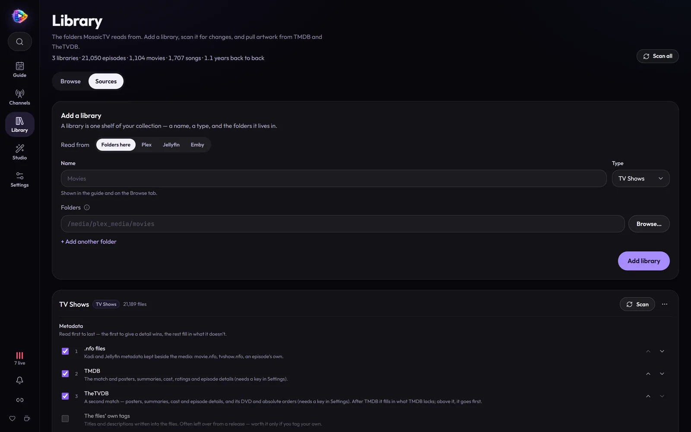
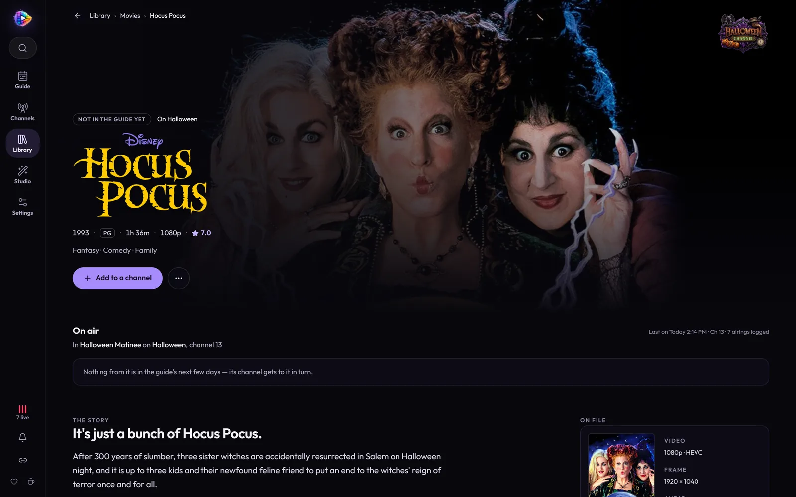

# Your Library

Everything MosaicTV can put on the air comes from its libraries: folders of
TV, movies, music videos and music, indexed the way Plex indexes them, with
artwork and details from the sources you choose. This page covers adding and
scanning them, metadata and logos, fixing a match, music, and finding your way
round the **Library** page.


**Library** has two tabs: **Browse**, your libraries and what's in them, and
**Sources**, the folders they read and where their details come from. Above
them, what you have between them all — libraries, episodes, movies, songs and
how long it would take to watch it back to back — and **Scan all**.

## Adding a library

**Library → Sources → Add a library**, as in
[Getting Started](getting-started.md#1-add-a-library): a name, a type, and
one or more folders under `/media`.



| Type | Holds | Read as |
| ---- | ----- | ------- |
| **TV Shows** | Episodes | Show / season / episode, from the folders and names |
| **Movies** | Movies, and their extras | A movie per folder or file |
| **Music Videos** | Music videos | Artist / album / title |
| **Music (songs)** | Audio files | Each song's own tags first, then its folders |
| **Other / Bumpers** | Anything else | Just files, by name |

A library's row under **Sources** has its folders (**Folders here**, add or
remove one), its **Metadata** sources in order, its **Scan** button and a
**⋯** menu: **Force rescan…**, **Match unmatched**, **Refresh all
metadata…** and **Delete library…**.

### Folders and naming

MosaicTV expects Plex-style naming, which you likely already have:

```
TV/Show Name (2005)/Season 01/Show Name - S01E01 - Episode Title.mkv
Movies/Movie Name (1999)/Movie Name (1999).mkv
```

Everything in the folders is indexed, as in Plex — season 0 (shown as
**Specials**) and **extras** too: featurettes, trailers, interviews and deleted
scenes filed with a movie or show (an `Extras`, `Featurettes`, `Trailers`,
`Behind The Scenes`… folder inside its folder, or a name ending in
`-featurette`, `-trailer` and so on). A movie's extras are listed with the
movie, a show's on its page; the movie library's **All** tab → filter →
**Unattached extras** finds any with no movie of their own. Whether they air
is up to each channel (see [Specials and extras](channels.md#specials-and-extras)).

**Shows of one name but different years are kept apart.** A folder's year
makes it a show of its own, titled with that year, so *Scrubs (2001)* and
*Scrubs (2026)* are two shows and the revival's episodes don't land in the
original. A folder with no year, or the same year, joins the show of its name,
so `Gargoyles (x264)` stays with `Gargoyles (1994)`.

A **`.plexignore`** file is honoured the way Plex reads it: one pattern a line
(`#` for a comment), relative to the folder it's in — `*.wav`, `Extras/*` —
with `*` and `?` standing for characters of one name. A folder a pattern
matches is left out whole, so a `.plexignore` holding just `*` keeps its
folder out of the library. Files it leaves out that were indexed before go at
the next scan.

### From Plex, Jellyfin or Emby

Already have a Plex, Jellyfin or Emby server that knows your shows? **Read
from → Plex / Jellyfin / Emby** on the Add a library card reads a library from
it instead: its show names, seasons and episode numbers, episode titles,
descriptions, genres, ratings, dates, artwork and logos. MosaicTV still plays
the files itself, from disk — nothing is streamed through the server — so the
files have to be mounted where MosaicTV can see them too.

1. Give the server's **address** (`192.168.1.10:32400` for Plex,
   `…:8096` for Jellyfin and Emby) and its key:
   - **Plex** — your token: in Plex Web, open any movie or episode's ⋯ menu →
     **Get Info** → **View XML**; the address that opens ends in
     `X-Plex-Token=…`.
   - **Jellyfin** — **Dashboard → API Keys → +**.
   - **Emby** — **Settings → API Keys → New API key**.
2. **Connect**, and pick one of its **TV or movie** libraries (music is read
   from its folders).
3. Say **where its folders are here**: the server sees its files at its own
   paths (`/data/tv`, `D:\TV`); point each at the same folder inside MosaicTV.
   Where it can tell, MosaicTV fills these in.

Then **Scan** it. The scan indexes the files as for any library, then reads
the server and matches each file to it by path. The library's card says how
many of the files the server lists were found here, and names one that
wasn't — the way to check the folders are right. A show MosaicTV had filed by
its folder name joins the server's show (its collection picks and broadcast
episodes with it), and every scan reads the server again. The key stays on
the MosaicTV server: artwork is fetched through it.

## Scanning

**Scan** on a library, or **Scan all** at the top of the Library page to scan
every library one after another (the button says which it's on — "Scanning 2
of 5" — and the notification bell sums up what they found). A progress bar
tracks files as they're probed (duration, resolution, codecs via ffprobe) and
parsed. If one library can't be scanned, the rest still are.

Re-scans are incremental — unchanged files are skipped, and files gone from
disk are removed, as in Plex. Not while their folder can't be read, though: a
share that isn't mounted looks like every file in it gone, so those wait,
hidden, for a scan that can read it. **Force rescan…** reads every file again
from scratch (a file's length, say, after you replaced it).

The library follows the scan as it runs, as Plex's does: new titles turn up
where they sort and removed ones go, on the grid and on any show, movie or
artist page that's open — no refresh, and the page stays where you'd
scrolled. Posters and names a metadata fetch brings in arrive the same way.

## Metadata: posters, summaries and logos

Like Plex's agents, each library reads its metadata from a list of sources,
first to last — the first to give a detail wins, the rest fill in what it
doesn't. Set them on the library's row under **Sources** → **Metadata**: tick
the ones to read, and move them up and down.

- **.nfo files** (on by default) — Kodi and Jellyfin metadata kept beside the
  media: `movie.nfo` or `<movie>.nfo`, `tvshow.nfo`, an episode's own
  `<episode>.nfo`. An .nfo that names a TMDB, IMDb or TheTVDB id matches the
  title by that id.
- **The files' own tags** (off by default) — titles and descriptions written
  into the files. Often left over from a release; worth it if you tag your own.
- **TMDB** (on by default) — needs a free key: **Settings → Metadata** → paste
  your [TMDB API key](https://www.themoviedb.org/settings/api) → **Save**.
  Every library that reads TMDB looks its titles up straight away, and from
  then on whatever a scan adds is read straight after it, as in Plex.
- **TheTVDB** (on by default, after TMDB) — **Settings → Metadata** → paste a
  [TheTVDB API key](https://thetvdb.com/api-information) (and, for a
  user-supported key, your subscriber PIN) → **Save**. After TMDB it fills in
  what TMDB doesn't have — titles TMDB has never heard of, a missing summary
  or episode name; move it above TMDB and it goes first. A title matched on one
  is found on the other by the ids the first lists for it, not guessed again
  by title.

You get posters, backdrops, summaries, genres, ratings (TV-Y7, PG-13),
taglines, studios and networks, directors and creators, cast, and for every
episode its name, first air date and a still — shown in the Library and sent
in your players' guide data. An episode whose file names it keeps that name;
one whose file doesn't ("Show - S01E02.mkv") takes the name its metadata gives.
If a file names its episode something quite different from a source's episode
at that number — a cartoon split into its segments — that source's details are
left off it rather than showing another episode's; likewise when TheTVDB names
the episode at a number otherwise than TMDB does (the first source in the list
wins). Local artwork (`poster.jpg`, `folder.jpg`, Plex/Kodi/Jellyfin naming) is
used first when present.

**Logos.** A show's or movie's logo — its name as artwork, like the *Dexter's
Laboratory* wordmark — stands in for its name wherever one was found: on its
page, at the top of the Guide, on the library's **On air now** shelf, on TV
mode's glass strip and on the up-next cards. They come from the same sources
as posters, in each library's order (TMDB's English or wordless logos,
TheTVDB's clear logos, a Plex, Jellyfin or Emby server's), and a logo file
beside the media comes first: `clearlogo.png` or `logo.png` in a show's
folder, and for a movie `<Movie name>-clearlogo.png`, `clearlogo.png` or
`logo.png` (PNG or WebP, so it can be see-through). Every logo is fetched
ahead, in the background, so it's there the first time it's shown. A title
with no logo keeps its name as text.

A movie or show is found by its title and year — or, like Plex and Jellyfin, by
an id in its folder name: `The Matrix (1999) {tmdb-603}`, `{imdb-tt0133093}`,
`The Office {tvdb-73244}`, `[tmdbid-603]`. The id is left out of the title.

The library's **⋯** menu (on its page, and under **Sources**) has **Match
unmatched** — look up what isn't matched yet — and **Refresh all metadata…** —
read everything again from the library's sources, keeping the matches you
fixed by hand. **Settings → Metadata** lists every library with the same.

### Fixing a wrong match

As in Plex: open a movie (or a show's page) and choose **Fix match** (or
**Match**, for one that isn't matched yet). Pick the source — TMDB or TheTVDB,
numbered in the order the library reads them — then search it by title and
year, or paste a TMDB, TheTVDB or IMDb link, and pick the right one.


A match you pick is kept: refreshing metadata never searches that source for
the title again, and the other source follows your pick where it lists the
title. **Keep it** keeps the match it has. **Not there** takes the match away
and leaves the title unmatched on that source for good — lookups leave it
alone there — then moves on to the other source if that has nothing either.
Say it on both, and a home video neither source has stays **Unmatched by
hand**, with only what its files and folders say.

The search also finds a title by its link: paste its TMDB, TheTVDB or IMDb
address in place of a title.

A library's **All** tab has a **filter** for what wants a look: **Unmatched**
(no source has it), and **Check matches** — automatic matches whose year is off
from the file's by more than a year, or whose title doesn't look like it.
**Fix them one by one**, beside the filter's note, opens Fix match on each in
turn: pick one, or **Skip**, and it goes on to the next.

### Episode order

As Plex lets a show pick TheTVDB's DVD or absolute order, a show's **⋯** menu
→ **Episode order…** picks one for it: as aired, one of TMDB's episode groups
(DVD, absolute, production — whatever TMDB has for that show) or one of
TheTVDB's orders. An order of one source's is read from that source alone.
Only the episodes' names, dates and pictures follow it; the files keep their
numbers, and so do the schedule and your broadcast episodes.

### Renaming and merging shows

A show's **⋯** menu also has **Rename…** — what it's called everywhere — and
**Merge into another show…**, for a show that was filed twice (two folder
names for one series). Both keep the show's episodes, collection picks and
broadcast episodes together, and the dialog says what the next scan will do.

## Browsing

**Library → Browse** shows a tile for each library — how many titles it has,
how many are on a channel, how many are **off air**, and what from it is on
right now — and shelves of what was just added.

Open a library and it has its own tabs:

- **Home** — what from it is **on air now**, the next hours of the channels
  airing it, what was **just added**, how much of it no channel airs yet
  (**Off air**), and its titles by decade.
- **All** — every title as a poster grid, with an **A–Z** bar down the side,
  sorting (title, newest, most episodes, highest rated) and the match filter.
- **Off air** — just the titles no channel plays yet, to find what's missing
  from your lineup.


The search at the top of the rail (**Ctrl K**) finds any show, movie or
artist across every library; on a library's page it also offers **Everything
matching "…"**, which narrows that library's grid to what matches.

### A show's page

Open a show and its page opens over the grid, which stays where you'd
scrolled underneath:


- **Up top** — its logo (or name) over its backdrop, its years, seasons,
  episodes and running time, and — while it's on — **LIVE** with the channel
  it's on and until when. **Tune in** goes straight to it in TV mode; **Add to
  a channel** puts it in a channel's collection.
- **On air** — the channels carrying it, its next airing, the evening around
  it as a strip of the guide, and **Coming up**: every airing in the next days.
  A show no channel airs says so, with **Add to a channel**.
- **The story** — its summary, who made it, its network, ratings, the episode
  order it follows, and the folder names it was filed from.
- **Cast**, then its **seasons**: every episode with its still, name, air date,
  when it last aired and when it's next on, and its broadcast-episode tag.
  **Group broadcast episodes** on a season puts its segments back into the
  half-hours they aired as — see
  [Broadcast episodes](channels.md#broadcast-episodes-multi-segment-shows).
- **Extras**, when it has any.

A movie's page is the same shape — its logo, story, cast, extras, and **On
file**: its picture size, codecs and runtime.



### Putting anything on a channel

Anything in a library goes onto a channel from its **⋯** — a show, a season
or one episode, a movie, an artist, an album or a song — or by a long press
on a phone, or a right-click: **Add to a channel…**, then pick one of a
channel's collections. A title can be in any number of collections (a show in a
weekday block's and a Saturday one's), but a collection takes it once: one that
brings all of it in already — its whole show, its album, a smart filter — says
**Already in**, and one with some of it says how much and adds the rest.

On a phone or tablet, what a mouse finds on hover is simply shown — each
item's **⋯**, a channel card's Watch button — and a collection's posters are
moved and removed with a long press (move earlier or later, or remove), in
place of the mouse's drag and **×**.

## Music

### Music videos

**Music Videos** parse artist and track out of the folder layout — any of
these work:

```
Music/Artist/Album/Title.mkv
Music/Artist/Title.mkv
Music/Artist - Title.mkv
```

A music video's title comes off its name without the YouTube noise —
"(Official Music Video)", "[4K]", yt-dlp's `[id]`, a repeated "Artist - ".
Its picture is its own (`<video>.jpg`), else its album folder's cover, else the
cover inside the file (as yt-dlp and Pinchflat embed them); an `artist.jpg` in
the artist's folder pictures the artist. A music-video channel shows a **Now
playing** card naming the track as each one starts, and its guide entries read
"Artist – Title" with the album as the sub-title.

### Songs

**Music (songs)** holds MP3, FLAC, M4A/AAC, Ogg, Opus, WAV, WMA, AIFF and the
like. A song goes by its own tags first (title, artist, album, year, track,
disc), then by its folders and name:

```
Music/Artist/Album/03 - Title.flac
Music/Artist - Title.mp3
```

Songs are filed under their **album artist**, as Plex and other music apps
file them, so an album stays one album whoever sings or wrote each song: a
soundtrack tagged *Various Artists* is one album under Various Artists, a
game-music set under its series. Each song keeps its own artist — shown
beside it on the album, in the guide and on the now-playing screen, and what
MusicBrainz and LRCLIB are asked by. A track tagged as part of a compilation
with no album artist files under Various Artists. An album tagged with no
album artist at all, whose songs credit different people, is still one album:
under the name every credit begins with (*Eminem* beside *Eminem feat.
Rihanna*), else Various Artists.

Its cover is its album folder's (`cover.jpg`, `folder.jpg`, `front.jpg`) or the
one inside the file. Timed lyrics come from a `.lrc` file beside it
(`03 - Title.lrc`) or from its tags. A song has no picture, so it airs over a
**now playing** screen — see [Channels → Music](channels.md#music).

### Music sources

A Music Videos library reads its Kodi `<musicvideo>` .nfo files and its
videos' own tags (both on to start with); a Music library reads every song's
tags as it's scanned. Either can also switch on, free and with no key:

- **MusicBrainz** — the album a song is on, the year it first came out, its
  genres, and the album's cover from the Cover Art Archive, for whatever the
  files don't say. It's asked a request a second, as MusicBrainz asks, so a big
  library takes a while the first time; each album is asked about once for all
  its songs, and live bootlegs and compilations are passed over for the studio
  album.
- **LRCLIB** (Music libraries) — timed lyrics for songs that have none of their
  own, for the Lyrics screen.

A music video's artist, album, title and year are its folders' and name's: the
sources only fill in what those don't say, so an artist's picks stay put.

### Browsing music

A Music or Music Videos library is filed as a music app files it: **Artists**
(the default), **Albums**, or every **Song** (or video). An artist's page shows
where they air and their albums as covers, oldest first (music on no album
last, as *Singles & other songs*); an album opens its own page of songs in
order, each with the artist it credits. An artist with one album lists its
songs straight away. **Add to a channel** is on both pages — for the artist,
or for one album. An artist picked into a collection brings in their albums
and any song that credits them.


