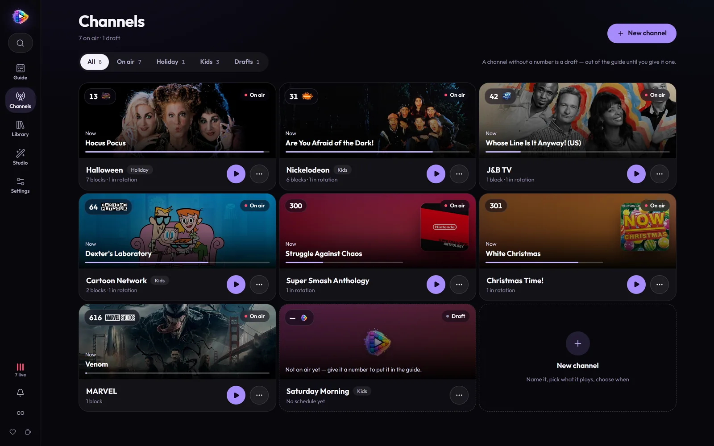
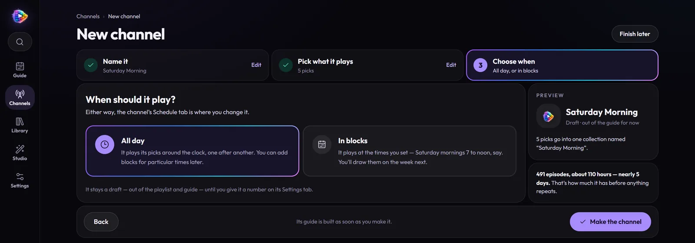
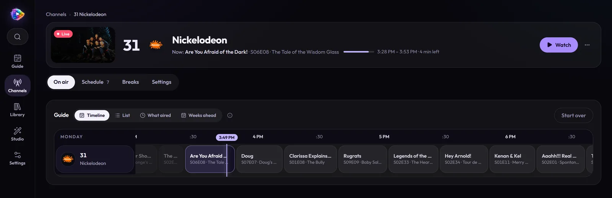
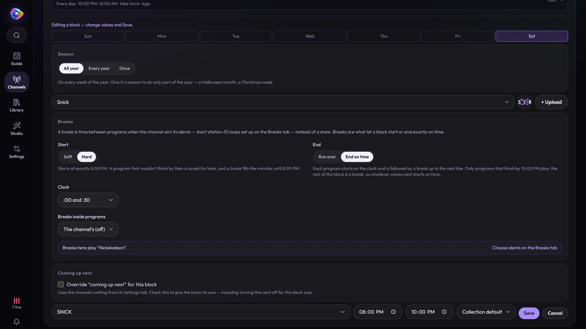
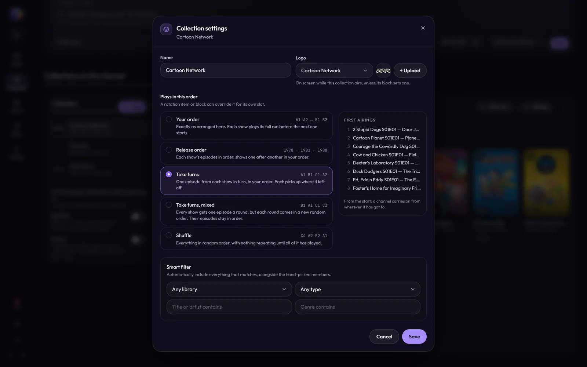
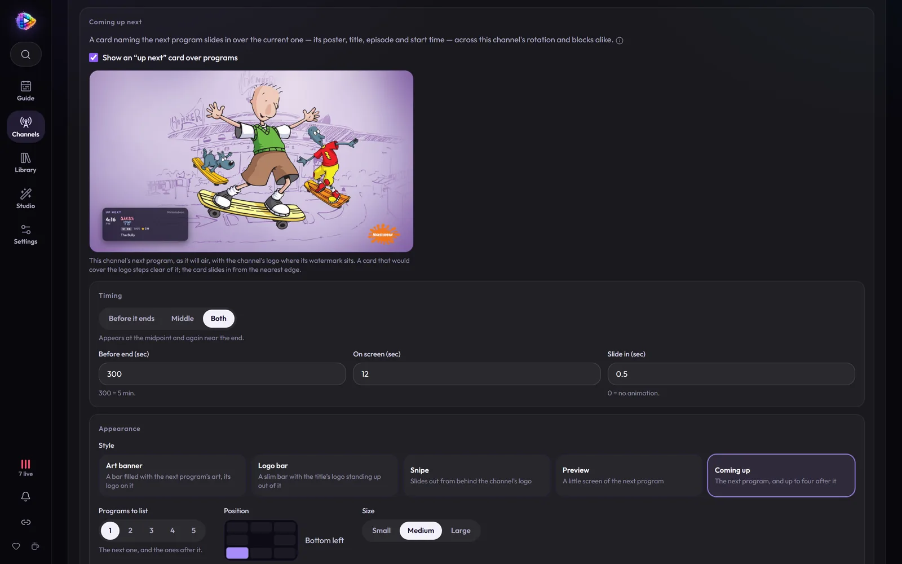
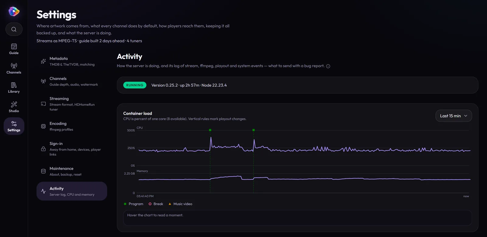

# A tour of MosaicTV

Every screen, one after another, from a real MosaicTV running a handful of
channels: Cartoon Network as it was around 2001, Nickelodeon's 1996 lineup
with SNICK on Saturday night, a Halloween movie channel, a sitcom channel, a
Marvel channel, a Christmas music channel and a video-game music station.

- [The Guide](#the-guide)
- [Channels](#channels)
- [A channel's page](#a-channels-page)
- [The Library](#the-library)
- [Studio](#studio)
- [Settings](#settings)
- [TV mode](#tv-mode)
- [What your viewers see](#what-your-viewers-see)
- [Search, notifications and Live TV setup](#search-notifications-and-live-tv-setup)
- [On a phone](#on-a-phone)

The app has five places, down the rail on the left: **Guide**, **Channels**,
**Library**, **Studio** and **Settings**, with search at the top and, at the
bottom, how many channels are live, the notification bell and **Live TV
setup**. On a phone they're a bar along the bottom.

---

## The Guide

The home page. One channel large at the top — its live picture, the title's
logo, the episode and how far in it is — with what's up next on it beside.
Under it, every channel in the grid: a red now-line, programs you can open,
broadcast episodes with their parts and breaks marked along the bottom, and
music as hour blocks.

→ [Watching](watching.md#the-guide)

## Channels

Every channel as a card: its number and logo, what's on now over the
program's artwork with how far in, and the shape of its schedule. Filter by
group; drafts have their own tab.

**New channel** makes one in three steps — name it, pick what it plays from
your posters, and choose all day or blocks:

→ [Getting Started](getting-started.md#4-make-a-channel)

## A channel's page

One header with the channel's live picture, number, logo and what's on, with
**Watch**, and four tabs.

### On air

The channel's guide as a **Timeline** or a **List**, **What aired** (a day, a
week or a month back), and **Weeks ahead** — the schedule laid out 2, 4 or 8
weeks ahead without saving anything: how late each block really starts, break
time a day, and when each show goes back to an earlier episode.

### Schedule

The broadcast clock, holiday episodes, the **Rotation** — the 24/7 default —
and **Time blocks** on a weekly grid. Click an empty slot to start a block
there, or a block to edit it: its days and times, season, logo, breaks and
up-next card. Notes at the top point out the traps before they air.

At the foot, **Collections on this channel**: what the rotation and blocks
play from, as posters in the order they take turns, each with its playback
order, logo and smart filter.

→ [Channels & Scheduling](channels.md)

### Breaks

What plays between programs: when the next break is, which blocks have
breaks, the channel's **idents** in the order they take turns, a week map
coloured by the ident each block plays, and **Promos**.

→ [Station breaks](branding.md#station-breaks)

### Settings

Number, name, group, encoding profile, audio language and logo; the
**Picture** (its programs, or the guide); the **Coming up next** card with a
live preview of the card your next program will get; and, for music, the
now-playing screen.

## The Library

Each library as a card — a wall of its posters, how much is on now, on a
channel, and off air — with shelves under them. Open one for its **Home**:
what from it is on air now, the next hours of the channels airing it, and
what was just added.

Every show and movie has a page: its logo over the backdrop, **Tune in**
when it's on, **Add to a channel**, its next airing in the evening around it,
and its seasons and episodes — a broadcast episode's segments tagged with
their place.

Music is filed as a music app files it — artists, albums, songs — and an
artist's page shows where they're on and their albums as covers.

→ [Your Library](library.md)

## Studio

The branding kit: **Logos** (each with its own watermark, previewed over a
frame from your library), **Music** for breaks, and **Clips** for idents of
your own.

→ [Branding](branding.md)

## Settings

Seven sections: **Metadata** (TMDB and TheTVDB), **Channels** (guide depth,
audio, the default watermark), **Streaming** (stream format, the HDHomeRun
tuner), **Encoding** (profiles), **Sign-in**, **Maintenance** (version,
backup and restore, reset) and **Activity** — the server's status, its CPU
and memory, and the log.

## TV mode

**Watch** turns the browser into a TV: full screen, a slim glass strip along
the bottom as you tune in, ↑/↓ to flip, a number to jump, **G** for the
guide, picture in picture, and looks that put the shows back on a CRT.

→ [Watching](watching.md#tv-mode)

## What your viewers see

Whatever they watch on — TV mode, Plex, Jellyfin, an IPTV app — the
channels look the part.

**Up-next cards** slide in near the end of a program, in five looks:

**Station idents** fill the breaks, made from the channel's logo:

**Promos** for what's on later:

**Songs** air over a now-playing screen:

And a **guide channel**, like the old cable guide, for players that can only
tune channels:

## Search, notifications and Live TV setup

**Search** (Ctrl/⌘ K, or the magnifier at the top of the rail) finds
channels, every show, movie and artist, and settings sections. The **bell**
follows scans, metadata fetches and ident builds with live progress. **Live
TV setup** has your M3U, XMLTV and tuner addresses with copy buttons and steps
for each player.

<table>
  <tr>
    <td width="50%"></td>
    <td width="50%"></td>
  </tr>
</table>

## On a phone

Every screen works at phone width, with a tab bar along the bottom and long
presses in place of right-clicks and drags.

<table>
  <tr>
    <td width="25%"></td>
    <td width="25%"></td>
    <td width="25%"></td>
    <td width="25%"></td>
  </tr>
</table>
