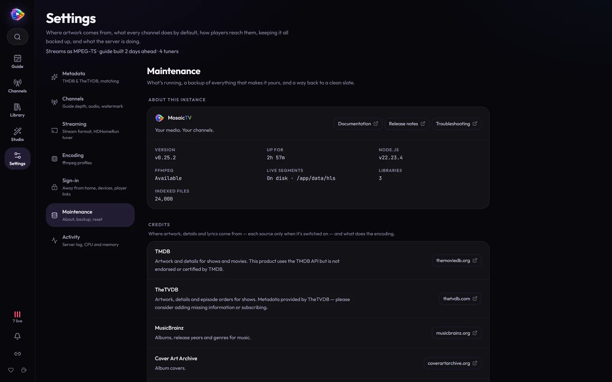

# Troubleshooting & Backup

## First stop: the log

**Settings → Activity** shows the live application log — scans, stream
starts/stops, ffmpeg fallbacks, errors — and has a download button for filing
issues. Most mysteries are explained there.

## Second stop: the Container load chart

**Settings → Activity** also has the server's status, and graphs container
CPU and memory over the last 5/15/60 minutes,
with a vertical rule at every playout change — an episode, a break, or a music
video starting. Hover any point to read the exact figures and what was playing.

Read it for *step changes*, not spikes: every transition spawns an encoder, so a
brief jump at each rule is normal. What matters is CPU that climbs at a rule and
never comes back down — that names the item that cost you.

CPU is shown as **percent of one core**, so on an 8-core box 800% is fully
saturated. If the chart warns that no cgroup was found, the numbers cover the
app process only and exclude ffmpeg — the figures are meaningless in that case.

## Common issues

### Settings › Activity says "No ffmpeg"
Only possible in non-Docker/dev setups (the Docker image bundles ffmpeg).
Install ffmpeg and make sure it's on the PATH.

### My library scanned 0 items
- The library **path** must be the *container* path (under `/media`), not the
  host path. Host `/mnt/user/media/tv` ⇒ container `/media/tv`.
- Check the volume mount actually contains your files:
  `docker exec mosaictv ls /media`.
- Filenames need to be Plex-style parseable — see
  [Getting Started](getting-started.md#1-add-a-library).

### A library from Plex, Jellyfin or Emby says "Can't reach …"

Its card shows the address MosaicTV reads the server at and why the last try
failed. **Nothing answered at that address** means the server is down or on
another address or port; **turned the key down** means its sign-in ended —
sign in again under **Add a library → Read from**, and the libraries move to
the new one. MosaicTV runs in its own container network, so an address that
works in your browser (`localhost`, a name only your PC knows) may not work
from it: use the server's address on your home network. Until it's back,
the library keeps what it had, and a scan once it is catches up.

### Shows/movies have no posters
- Add a **TMDB** or **TheTVDB** key (Settings) and run **Match unmatched**
  from the library's **⋯** menu.
- Still none? The library's filter → **Unmatched** lists what neither source
  found; open one and **Match** it by hand on either (a TMDB, TheTVDB or IMDb
  link works too), or **Fix them one by one**.
- The wrong poster? **Check matches** lists automatic matches that look off;
  open one and **Fix match**.
- Local artwork is only picked up during a **scan** — rescan after adding
  `poster.jpg`/`folder.jpg` files.

### A channel isn't in the M3U / guide
- Draft channels (no **number**) are excluded on purpose — set a number.
- The channel needs a schedule — a rotation and/or blocks with something in
  them. Its guide builds by itself from there; the channel's **On air** tab
  shows it, and the log says why if it couldn't ("couldn't rebuild the
  guide").

### The stream stops when a second device tunes in
That's your *player's* tuner limit, not MosaicTV: raise Jellyfin's
*Simultaneous stream limit* (0 = unlimited), or give Threadfin/xTeVe more
tuners for Plex. MosaicTV happily serves them all, from one encode per
channel.

### Playback stutters / CPU is pegged
- The cost is how many **different** channels are being watched at once:
  viewers of the same channel share one encode (see
  [Connecting Players](clients.md#streaming-mode-shared-hls-vs-mpeg-ts)).
- Lower the encoding profile (720p, faster preset), or
- enable [hardware acceleration](hardware-acceleration.md).
- Remember: only channels **being watched** are encoded.
- Look for `encoder slower than real-time` in the log (**Settings → Activity**) — that's the encoder
  failing to keep up, and it's what viewers see as freezing.
- Cross-check the **Container load** chart in **Settings → Activity**: if CPU steps up at one
  transition and stays there, that item (or the profile it's using) is the cost.

### Schedule times are off by hours
Set the `TZ` environment variable to your timezone and restart the container.
Every channel's guide is rebuilt for the new timezone when it starts.

### I edited my schedule but the stream still plays the old one
Edits take effect from the next program: the one on now plays out first, and
so does one starting within about 20 seconds. The channel's **On air** tab says
where the change took effect ("Updated from …"). If nothing changes after
that, look in the log (**Settings → Activity**) for "couldn't rebuild the guide".

### GPU isn't being used
Check the [Hardware Acceleration](hardware-acceleration.md) setup for your
platform, then look in the log (**Settings → Activity**) for either:

- `Video encoder selected: …` — what MosaicTV actually settled on, or
- `Profile requests <vendor> but <encoder> does not work on this host` — the
  encoder failed its startup test encode, so the stream fell back to the CPU.

MosaicTV verifies an encoder by really using it, so this warning means the
encoder is genuinely unusable here, not merely unlisted. On NVIDIA,
`docker exec mosaictv nvidia-smi` should list your GPU; if it doesn't, the
container isn't seeing the card (runtime/toolkit issue). On VAAPI, make sure
`/dev/dri` is passed into the container.

### A program shows the station ident instead
The channel couldn't play that file, so it covered the slot and moved on to the
next program on time. The log (**Settings → Activity**) says why:

- `… retrying it on the CPU` then `… holding the rest of its slot with the
  station ident` — the file failed on the GPU and again on the CPU. The line
  above each (`encoder exited …`) carries ffmpeg's own error, usually a damaged
  or unreadable file. Check that it plays elsewhere, then rescan the library.
- `… ended Ns before its slot` — the file is shorter than the length the
  library recorded for it. **Force rescan**, in the library's **⋯** menu,
  re-reads every file's duration.

---

## Backup & restore

Everything MosaicTV owns lives in **one folder**: the `/app/data` volume
(database, uploaded logos, music and clips, built idents). Your media is never
touched.

- **In-app:** **Settings → Maintenance → Download a backup** — grabs
  the database, logos, music and clips, and the covers copied out of your
  music files, in one archive. It leaves out what MosaicTV makes again by
  itself: the live streams' segments, built idents, now-playing screens,
  thumbnails, downloaded artwork, the log, and the copies under `backups/`.
- **Manual:** stop the container and copy the host folder mapped to
  `/app/data`.

**Restore:** **Settings → Maintenance → Restore a backup**, and pick the
`.tar.gz`. MosaicTV checks it (a backup from a newer version is turned away —
update first), then restarts and puts it in place as it starts, before
anything opens the database; a backup from an older version is upgraded as it
comes in. The database it replaces is kept as
`backups/pre-restore-<date>.db` in the data folder. Idents rebuild and artwork
downloads again in the background.

The restart needs the container to start again on its own: with
`--restart unless-stopped` (the compose file and the `docker run` example
have it) it does. **On Unraid** it doesn't by default — the page says so if
it's waiting, and the backup goes in when you press **Start** in the Docker
tab. Adding `--restart unless-stopped` to the container's **Extra
Parameters** makes it automatic.

**By hand:** stop the container, empty the data folder (or at least delete
`mosaictv.db-wal` and `mosaictv.db-shm` — left beside a restored database
they'd be read as part of it), extract the backup into it, and start it
again.

**Upgrades take their own copy.** When a new version changes the database, it
first saves a copy of it to `backups/` in the data folder
(`pre-migration-<date>-<change>.db`, the newest five are kept). If the change
fails, the database is put back from that copy automatically and the log says
so — the previous image will start on it. To go back to a version from before
an upgrade that *did* apply, stop the container, copy that file over
`mosaictv.db` (delete `mosaictv.db-wal` and `-shm` beside it), and run the older
image.

**Reset:** **Settings → Maintenance → Reset to a clean slate** wipes the
database (optionally also uploaded logos, music and clips) for a fresh start — take a
backup first.

## Still stuck?

Open an issue: <https://github.com/TronVonDoom/mosaictv/issues> — include the
downloaded logs and what you expected vs. what happened.
