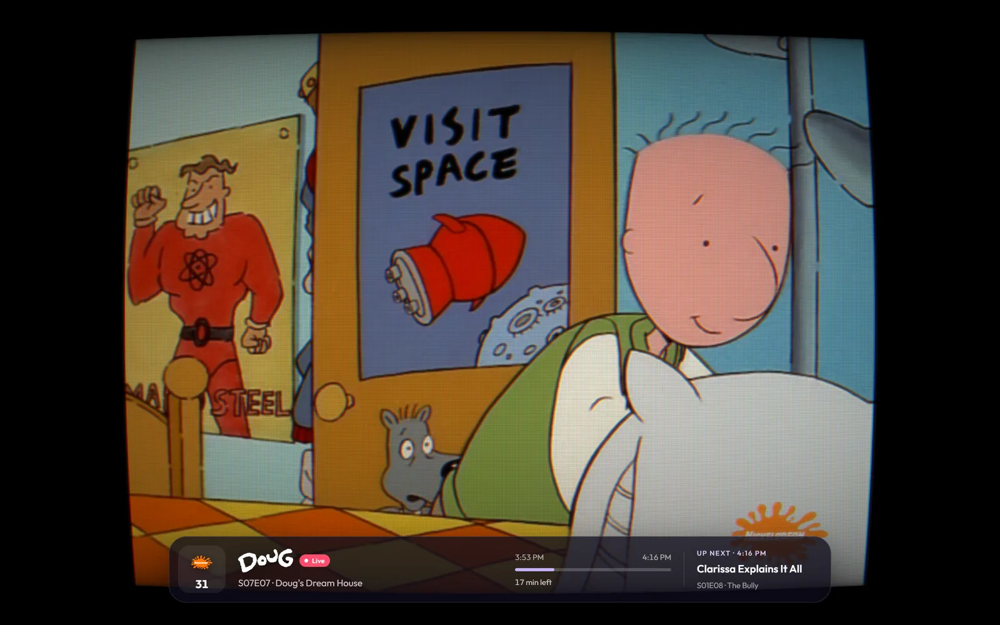
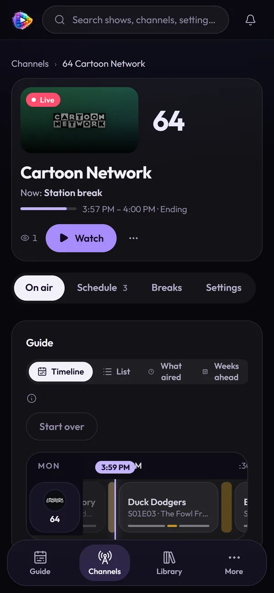

# Watching

Three ways to watch, all at once if you like:

- **The Guide and TV mode, in your browser** — on this page.
- **Your players** — Plex, Jellyfin, Emby, VLC, TiviMate and any IPTV app,
  through M3U + XMLTV or the built-in HDHomeRun tuner. See
  [Connecting Players](clients.md).
- **Casting** to a Chromecast, Google TV or Apple TV from TV mode
  ([below](#casting)).

Every channel is live TV: tune in and it's already playing, mid-episode,
right on schedule. Only channels someone is watching are encoded.

---

## The Guide

**Guide** is the home page. At the top, one channel large — its live picture,
the title's logo, the episode, how far in it is (a program that airs in parts
shows its parts and its breaks as a bar along its foot) — with what's up next
on it beside, **Watch** and **Open channel**. Under it, **All channels**: the
guide grid, with a red now-line and a time ruler.

- **Pick a channel** — tap its tile in the grid to bring it up top.
- **Open a program** — tap it for its details: the episode, its parts, when
  it airs, and a link to its show or movie.
- **12h · 24h · 48h** — how far the grid reaches; it also scrolls back three
  hours into what already aired, dimmed.
- **Compact · Standard · Wide** — how much room each half hour gets.
- **Now** — back to the present.
- A run of songs shows as **one block an hour**, named after its collection,
  with a mark where each song starts; open it for the set list.

The figures in the top corner say how many channels are on air and how many
people are watching. It's the same guide your players get in the XMLTV.

## TV mode

**Watch** — on the Guide, on a channel's card or page, or `/watch/<number>` —
turns the browser into a TV: the channel full screen, with a slim glass
**strip** along the bottom as you tune in: the channel's tile, the title's
logo over its episode, how far in (a broadcast episode's parts and breaks to
scale, and which part is on) and what's next. On a phone held upright the
strip stacks into a compact card.

### Keys

| Key | What it does |
| --- | ------------ |
| **↑ / ↓** (or swipe) | Channel up / down |
| **0–9** | Type a channel number to tune straight to it |
| **⌫** | Back to the last channel |
| **G** (or Enter) | The channel guide, over the picture |
| **I** | What's on (shows the strip again) |
| **M** | Mute |
| **− / +** | Volume |
| **R** | Looks: CRT, TV set, classic guide |
| **C** | CRT on or off |
| **F** | Full screen |
| **P** | Picture in picture |
| **?** | All the keys |
| **Esc** | Leave TV mode |

Move the mouse (or tap) and the same controls appear along the top, with
**Cast** and **instant flipping** (the ⚡ button): the channels either side
keep running, so a flip lands on a live picture — at the cost of an encoder
each.

### Looks

**Looks** (the TV button, or **R**) dresses the picture up for the shows it's
showing, in this browser only — the channels and every other player are
untouched:

- **CRT** (or **C**) — scanlines, a gentle curve and a glow, as on a tube TV,
  drawn on the graphics card.
- **TV set** — a 4:3 program framed by an old set, its channel number in the
  dial's little window, instead of black bars down the sides. It appears only
  while the picture has the bars, and goes when a widescreen program comes on.
- **Classic guide** — the channel guide in the blue, boxy look of a cable
  guide.

Each is remembered in the browser for next time.

### Picture in picture

The button beside Full screen (or **P**) pops the channel into a small window
that stays on top of other tabs and apps while the TV-mode tab stays open.
Its skip buttons flip channels, and so do media keys and the system's media
controls, which show what's on and the channel's logo. (Firefox has its own
picture-in-picture toggle on the video, so the button isn't shown there.)

## Casting

TV mode has a **Cast** button over the picture. Once a TV is playing, TV mode
is its remote: flip channels and the TV follows.

- **Chrome / Edge → Chromecast or Google TV.** Chrome only allows casting from
  a page opened over **HTTPS** (or `localhost`), so it works once MosaicTV is
  served over HTTPS — Tailscale's `tailscale serve` or a reverse proxy with a
  real certificate both do it. The TV plays the channel's stream itself, so it
  must be able to reach that same address. On plain `http://` the button
  explains this instead; Chrome's own menu (⋮ → Cast…) can still mirror the
  tab.
- **Safari → AirPlay.** No HTTPS needed; TV mode plays Safari's native stream
  so it can be handed to an Apple TV.

With [sign-in](security.md) on, a cast hands the TV a link of its own, so it
plays wherever the TV is.

## Parental controls

A channel, or a block of one — a late-night horror block, say — can be locked
behind a PIN.

1. **Settings → Parental controls**: set a PIN, 4 to 8 digits.
2. Lock a whole channel on its **Settings** tab (**Parental lock**), or just
   some hours with a block's **Parental lock** in its editor on the
   **Schedule** tab. A lock applies at once.

A locked channel — or a program a locked block starts — doesn't play in TV
mode until the PIN is entered, and the guide shows it as **Locked**, with no
title or picture. Entering the PIN (**Enter PIN** in TV mode, **Unlock** under
the guide or in Settings) unlocks everything in that browser for four hours,
or until it's closed; **Lock again** ends it sooner. Turning a lock off,
removing the PIN or changing the PIN asks for it too.

**A player's own channels.** A TV app or Plex given its own links (**Settings
→ Sign-in → Player links**) can be kept to some channels: open the player,
choose **Just these** and tick them. The others are left out of its M3U, its
guide and its tuner, and won't play through its links — the way to keep a
kids' TV to the kids' channels, whether or not sign-in is on.

Like a TV's own lock, it keeps a channel off the screen, not out of reach: the
library stays browsable, and anyone who can edit channels in the web app can
change a schedule. Give the kids' TV its own player links, and keep the web
app to yourself with [sign-in](security.md).

## On a phone

Everything works at phone width. The rail becomes a bar along the bottom
(**Guide**, **Channels**, **Library**, **More**), what a mouse finds on hover
is simply shown, and a long press opens a title's menu or moves a poster in a
collection. In TV mode, swipe up and down to flip.

<table>
  <tr>
    <td width="33%"></td>
    <td width="33%"></td>
    <td width="33%"></td>
  </tr>
</table>

---

Next: [Connecting Players](clients.md) →
